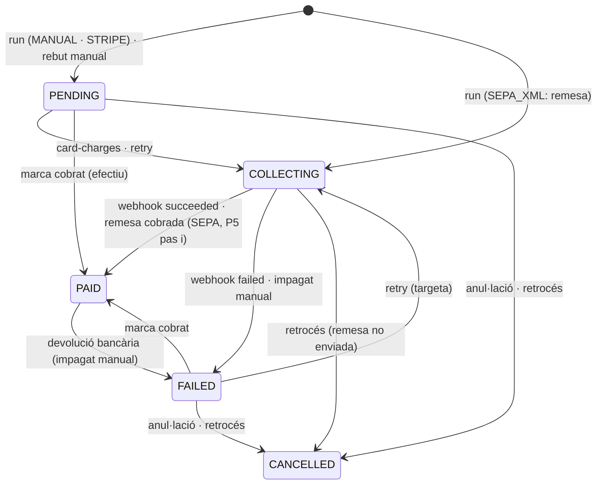
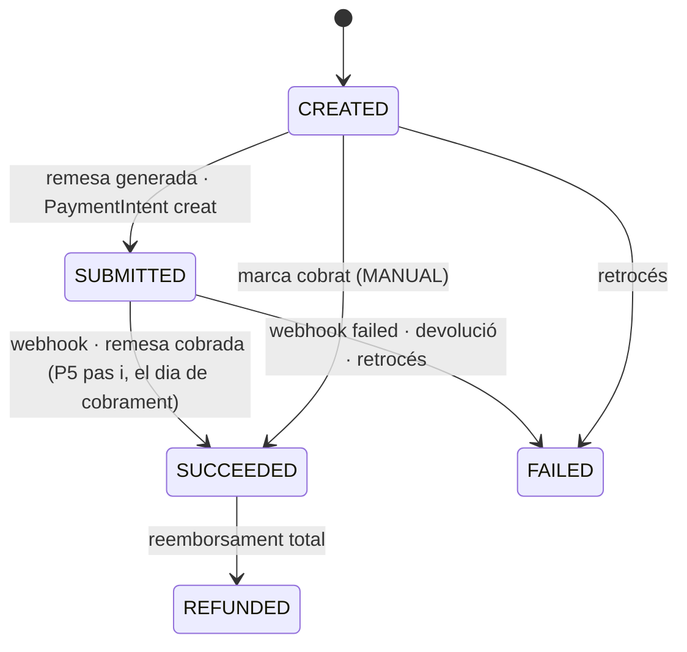

# S12 — Facturació i pagaments

**Etapa:** E8 · **Mòduls:** `BILLING` (tot el vertical), `PACKS`, `SINGLE_CLASS`, `INACTIVITY` (quota), `FAMILY_GROUP` (pagador únic) · **Pantalles:** D6 (`escriptori/D6-facturacio-simulacio-rebuts-i-remesa-sepa.html`), D8 (preus — només lectura, manteniment a S05), D10 (bloc «Rebuts recents» / «Tots els rebuts ›»), 13 (comptador de pack), 19 (pas de pagament — lliurament des de S04), 12 (entrada «Rebuts») · **Model:** v1.6 §D (REBUT/LINIA/REMESA, COBRAMENT_ANTICIPAT, CONSUM_PACK), MODALITAT/TARIFA; PLATAFORMA §2 (`CLUB.paymentProviders`), §3 (`Member.paymentMethod`, `Plan`, `Price`), **§4 (pagaments: és el model d'aquest vertical)**, §6 (outbox) · ADR-009 · **Estat:** esborrany (03-09-2026) · **Versió:** 0.1

## 1. Propòsit i abast

Resol **com el club cobra**: el cicle mensual de D6 (simulació → generació de rebuts → cobrament per proveïdor → conciliació), els **rebuts** (`Invoice`) neutres de proveïdor i **immutables**, els **intents de cobrament** (`Collection`) per `SEPA_XML` (remesa pain.008 al banc), `STRIPE` (targeta off-session, compte Stripe propi del club) i `MANUAL` (efectiu/transferència/Bizum), el **retrocés** d'una generació errònia, els **pagaments a l'acte** (`UpfrontPayment`: entrada, primer mes, packs, classe individual), els **packs** (`PackBalance`: obertura, consum, retorn, ajust, caducitat), la **classe individual** (línies per consum o pagament en reservar), els webhooks de Stripe, la vista de rebuts de l'abonat i l'**export per a comptabilitat**. Principi: el sistema emet **rebuts** (justificants de cobrament amb numeració pròpia); la factura fiscal, si cal, la fa la comptabilitat del club a partir de l'export (decisió del club 02-08-2026).

| Fora d'abast | On viu |
|---|---|
| Manteniment de modalitats i preus (`Plan`, `Price`, `PriceResolver`, `EntryFeeCalculator`) | S05 |
| Captura del mètode de pagament a l'alta, Checkout de l'alta, import cobrat a la validació | S04 (aquí: el processament del webhook i el que passa després) |
| Canvi de mètode de pagament per l'admin (`PATCH /members/{id}/payment-method`) | S03 (aquí: `mandateRef`, SetupIntent i «Targeta no vàlida») |
| Regles d'inactivitat i baixa (quins mesos es cobren) | S13 (`InactivityFeeService`, `LeaveBillingService`) — aquí es consumeixen |
| Consum i retorn de sessions de pack en reservar/anul·lar | S08 (crida `PackBalanceService` d'aquesta spec) |
| Assistència que dispara el càrrec de classe individual | S10 (emet `AttendanceMarked`; aquí es consumeix) |
| Caducitat de packs i recordatori de remesa (processos) | S15 (P5a, P10) |
| Motor d'exportació (`ExportJob`) i pseudonimització RGPD | S14 (aquí: `listKey = accounting` i `forgetCustomer`) |
| Facturació del SAAS al club, Stripe Connect | R4 (VISIO §6) |

## 2. Pantalles i rutes

| Mockup | App | Ruta | Rol | Comportament |
|---|---|---|---|---|
| D6 | clubs-admin | `/facturacio?mes=YYYY-MM` | ADMIN | Capçalera «{Mes} {any}» amb ‹ mes · mes › i tres accions: **[1 · SIMULA EL MES]** → `POST /billing/simulations`; **[2 · GENERA REMESA SEPA (XML)]** (etiqueta segons proveïdors: amb `SEPA_XML` el literal del mockup; només `STRIPE` → «2 · GENERA ELS REBUTS I COBRA LES TARGETES»; només `MANUAL` → «2 · GENERA ELS REBUTS» — assumpció §13) → confirmació forta («Es generaran {n} rebuts per un total de {import}. La data del proper rebut dels abonats avançarà al dia 1 de {mes+1}.»), amb SEPA un camp **data de cobrament** (per defecte `kpis.collectionDate`; l'admin en pot triar una altra, que ha de ser dia hàbil TARGET i deixar els 2 dies hàbils TARGET de marge, SEPA-05; web: camp «Data de cobrament» amb l'ajuda «Tria un dia hàbil bancari (TARGET) que respecti el termini de presentació SEPA configurat pel club.», que s'envia com a `collectionDate` només si l'admin canvia la data per defecte; `400 VALIDATION_ERROR` `NOT_BUSINESS_DAY` → al camp «El {data} no és un dia hàbil bancari (TARGET): el següent és el {dia}.» i [Genera amb cobrament el {dia}] amb `nextBusinessDay`; `422 COLLECTION_DATE_TOO_SOON` → [Genera amb cobrament el {earliest}] com abans; sense rebuts SEPA, cap camp) i la **diferència amb el total del mes anterior** (`simulation.comparison`: «{import} · {±dif} ({±%}) respecte de {mes anterior}», o «sense mes anterior per comparar»); amb `comparison.secondConfirmationRequired` (diferència, amunt o avall, de més de `billing.totalDifferenceConfirmPercent` = 20 %, o cap total anterior) demana una **segona confirmació explícita** abans de generar (SEPA-10; web: sota «Es generaran…», «Respecte del mes anterior ({mes}: {total anterior}): {±diferència} ({±%}).», «No hi ha cap mes anterior per comparar.» o, sense `comparison`, «Aquesta simulació no compara el total amb el del mes anterior.»; amb segona confirmació (o sense `comparison`), [Genera] mostra el pas «Segona confirmació» (el focus al seu títol): «El total d'aquest mes canvia un {±%} respecte del mes anterior ({mes}). El club demana una segona confirmació quan la diferència passa del {llindar}. Vols generar els rebuts igualment?» (o el text sense mes anterior / sense comparació), amb [Sí, genera els rebuts] (botó propi, sense el focus) i [Cancel·la], que no genera res) → `POST /billing/runs`; **[Retrocedeix la remesa]** (visible només amb una generació del mes retrocedible, R-12-14) → confirmació amb text a escriure («RETROCEDIR») → `POST /billing/runs/{id}/rollback`. Targeta «Pas 1 — Simulació: incidències primer» (recompte vermell + files «{nom} · {incidència} · Obre fitxa» → D10), «Actius amb pagament en efectiu» (files «{nom} · data de baixa prevista: {data} · Obre fitxa»), KPIs «Rebuts del mes · simulats el {data}», «Import de la remesa · data de cobrament: {dd/mm}», «En efectiu · pendents de marcar cobrat», «Quota d'inactivitat · {fee1} el 1r mes · {fee2}/mes». Amb `STRIPE`: KPI extra «Amb targeta · {n} · {import}» i, després de generar, botó **[COBRA LES TARGETES]** → `POST /billing/runs/{id}/card-charges` (assumpció). Llistat de rebuts (universal, CONVENCIONS §4) amb xips **Tots (n) · Pendents (n) · Remesats (n) · Cobrats · Impagats (n)**, accions **[Marcar cobrat (selecció)]**, **[Marca impagats (selecció)]** (rebuts d'una mateixa remesa, amb l'opció «torna'ls a presentar a la propera remesa»; SEPA-04) i **[Exporta per a comptabilitat]**; columnes Núm. · Abonat (→ D10) · Concepte · Import · Mètode («Domiciliació» · «Targeta» · «Efectiu») · Estat («remesat», «pendent · marca cobrat», «cobrat», «impagat (manual)», «impagat (targeta)», «anul·lat»). Fila → calaix del rebut (línies, cobraments, accions R-12-16…19; «Marca impagat» d'un rebut periòdic amb «Torna'l a presentar a la propera remesa», SEPA-04). Estats buit («Encara no hi ha cap simulació d'aquest mes»), carregant, error amb `traceId`. Amb la remesa `SUBMITTED` i abans de la seva data de cobrament: **[Desfés «enviada al banc»]** amb motiu → `POST /remittances/{id}/submission-undo` (R-12-15, SEPA-04). |
| D6 (remeses) | clubs-admin | `/facturacio/remeses` | ADMIN | Llistat de `Remittance` (mes, data, n rebuts, import, estat, fitxer) amb [Descarrega l'XML] → `GET /remittances/{id}/file` (fitxer `remesa-{period}-{seq}.xml`, `seq` = la seqüència del seu `MsgId`: un mes generat de nou després d'un retrocés mai reutilitza el nom; el d'una remesa `ROLLED_BACK` es diu `remesa-{period}-{seq}-ANULLADA-NO-PUJAR.xml` i la fila el marca «Anul·lada — no la pugis al banc» (web: distintiu vermell al costat dels botons de descàrrega, que es diuen «Descarrega l'XML (anul·lada, no la pugis al banc)» i «Excel de la remesa (anul·lada, no la pugis al banc)»; sense `Content-Disposition`, l'Excel es desa amb el mateix nom a partir del `messageId`); l'Excel de la remesa es diu igual amb `.xlsx`; SEPA-06) i [Marca com a enviada al banc] → `POST /remittances/{id}/submission` (assumpció §13: pantalla sense mockup, mateix patró de llistat). Una remesa `SUBMITTED` abans de la seva data de cobrament (data local del club) ofereix **[Desfés «enviada al banc»]** → confirmació «Desfés «enviada al banc» · {Mes} {any}» amb motiu obligatori (≤ 500) → `POST /remittances/{id}/submission-undo {reason}` (R-12-15, SEPA-04); avís «La remesa torna a estar generada: ja no consta com a enviada al banc.»; `409 INVALID_STATE` diu per què (`COLLECTION_DATE_PASSED`: «Ja ha arribat la data de cobrament de la remesa: ja no es pot desfer.»; `INVOICE_CHANGED`: «{n} rebuts de la remesa ja han canviat (impagats, cobrats o anul·lats)…») i el llistat es torna a llegir. |
| D6 (esdeveniments Stripe fallits) | clubs-admin | `/facturacio/esdeveniments-stripe` (sense mockup; enllaç «Esdeveniments Stripe fallits ›» a la capçalera de D6 d'un club amb `STRIPE`) | ADMIN | Llistat dels esdeveniments Stripe `FAILED` del club (`GET /billing/stripe-events`, PAY-02): id de l'esdeveniment (amb [Copia]), tipus, rebut el, intents, «es tornarà a provar el {data}» o «aturat el {data}»; el més recent primer, ordenable per «Rebut el»; sense filtres ni cerca. Sense accions: un esdeveniment aturat es torna a processar reenviant-lo des del tauler de Stripe (R-12-21), com diu la línia d'ajuda de la pantalla. Es dissenya amb el design system (§13). |
| D10 (bloc) | clubs-admin | `/abonats/:id` | ADMIN | «Rebuts recents» (5 darrers: número, concepte, import, estat) + «Tots els rebuts ›» → `/facturacio?filter=memberId:eq:{id}`; «Pagaments a l'acte» (entrada, packs) amb [Registra un pagament] → `POST /upfront-payments`; a cada pagament `PAID` cobrat amb targeta (`provider.type = STRIPE`: alta, pack o classe individual), [Reemborsa] → diàleg amb l'import (per defecte el que queda per reemborsar, `amountPaid` − `refunds[]`; o una part), el motiu (obligatori) i una confirmació → `POST /upfront-payments/{id}/refund {amount?, reason}` (R-12-20, PAY-05); la fila mostra els reemborsaments fets (`refunds[]`) i «Reemborsat» quan és `REFUNDED`. Web (PAY-05): el botó de la fila es diu «Reemborsa {concepte} ({import})» per a un lector de pantalla i no surt en una fitxa només de lectura (abonat suprimit); el diàleg «Reemborsa un pagament amb targeta» diu «{concepte}: pagat amb targeta {import}; queda per reemborsar {resta}.», demana «Import a reemborsar» (en blanc, tot el que queda; un import no positiu o més gran que la resta no deixa continuar: «Escriu un import positiu que no superi {resta}.») i «Motiu» (≤ 500), i [Continua] porta al pas «Confirma el reemborsament» (el focus hi va): «Es reemborsaran {import} a {abonat} pel pagament «{concepte}». Stripe els retornarà a la targeta amb què es va pagar, i no es pot desfer.» i «Motiu: {motiu}», amb [Reemborsa {import}] i [Enrere]; només aquest botó envia la petició, sempre amb l'`amount` confirmat (també «tot el que queda»), i una `Idempotency-Key`; `202` → «Reemborsament de {import} sol·licitat: es confirmarà quan Stripe el processi.» i la llista es torna a llegir; `422 REFUND_EXCEEDS_PAID` / `CURRENCY_MISMATCH` tornen al camp de l'import, `400` del motiu al seu camp, `409 INVALID_STATE` → «Aquest pagament ha canviat i ja no es pot reemborsar així. S'ha tornat a llegir la llista.»; cada reemborsament es llista sota la fila: «Reemborsament de {import} el {data}: {motiu}»; un pagament amb una disputa de Stripe (`dispute`, R-12-21, PAY-06) porta la marca «En disputa» (o «Disputa guanyada» / «Disputa perduda» quan Stripe la tanca) amb l'import, el motiu i la data; al calaix del rebut de D6, la mateixa marca al cobrament amb targeta disputat (`collections[].dispute`); Web (PAY-06): la marca és un distintiu (to de perill «En disputa» i «Disputa perduda», d'èxit «Disputa guanyada», neutre «Disputa tancada» per a un `warning_closed`) i, al costat, el text «El titular ha disputat {import} al banc ({motiu}) el {data}. Respon la disputa des del tauler de Stripe.» mentre és oberta, o «Disputa de {import} ({motiu}) oberta el {data} i tancada per Stripe el {data}.» quan és tancada; el motiu de Stripe en paraules com a N-56 (frau, cobrament duplicat, no el reconeix, servei no rebut, abonament no fet, motiu general) o tal com l'escriu Stripe («motiu: {codi}»); les dates, el dia del club; cap acció; per gos amb pack: «Pack {n} — {consumides} consumides · {disponibles} disponibles · caduca el {data}» + [Ajusta] → `POST /pack-balances/{id}/adjustments`; distintius «Compte no informat» (S03) i **«Targeta no vàlida»** (R-12-22). |
| 12 → «Rebuts» | clubs | `/rebuts` | MEMBER | Llista pròpia (`GET /me/invoices`): mes, concepte, import, estat («pendent», «cobrat», «impagat»); rebut → detall amb línies i [Descarrega el justificant] (`GET /me/invoices/{id}/document`, assumpció). Amb `CARD` i cobrament fallit: bàner «No hem pogut cobrar el rebut de {mes}» + [Actualitza la targeta] (R-12-22); el bàner (aquí i al perfil) només surt si el mètode actual de l'abonat (`GET /me.paymentMethod`) és `CARD`, amb l'últim rebut fallit amb targeta o la targeta marcada no vàlida: un abonat `SEPA_DD`, `MANUAL` o sense mètode no el veu, encara que el seu últim rebut fos amb targeta (PAY-09); un `409 INVALID_STATE` mostra l'avís d'error del botó. Sense mockup: es dissenya amb el design system (§13). |
| 13 (pack) | clubs | `/gossos` | MEMBER | «Pack {n} — amb {gos}» + barra + «{consumides} consumides · {disponibles} disponibles» + «caduca {data}» (`GET /me/pack-balances`), com al mockup 04/13. |
| 19 / 06 (Checkout) | clubs | retorn de Stripe | ANON · MEMBER | Retorn `successUrl`/`cancelUrl` (S04 R-04-26, S08 R-08-18): la confirmació real arriba pel webhook; la pantalla mostra «Pagament rebut» només quan `GET /checkout-sessions/{id}` retorna `PAID` (polling ≤ 10 s), si no «Estem confirmant el pagament…». |

## 3. Entitats i camps

Noms de codi (PLATAFORMA §0/§4). Tots amb `clubId`, índexs `{clubId, …}`; imports `Money {amountMinor, currency}` en la moneda del club.

### `Invoice` (`invoices`) — rebut (append-only)
| Camp | Tipus | Obl. | Validació / notes |
|---|---|---|---|
| `series`, `number`, `displayNumber` | string, int, string | sí | `displayNumber = "{series}-{number:04d}"` («2026-0912»); únic `{clubId, series, number}` entre els rebuts no anul·lats (R-12-08): un retrocés reemet el mateix número (R-12-14; decisió E87) |
| `issueDate` | date | sí | data local del club de la generació |
| `period` | `YearMonth` | sí | mes facturat («Setembre 2026») |
| `memberId`, `memberSnapshot {number, fullName, taxId?}` | | sí | instantània per a l'export |
| `lines[]` | `InvoiceLine[]` | ≥ 1 | `{lineNo, origin: MONTHLY_FEE · MAINTENANCE_FEE · INACTIVITY_FEE · SINGLE_CLASS · PACK · ADJUSTMENT, priceId?, bookingId?, description (congelada, `defaultLocale` del club), base: Money, taxPercent, tax: Money, total: Money}` |
| `total`, `base`, `tax` | Money | sí | suma de línies (R-12-09) |
| `paymentMethod` | congelat | sí | `{type: SEPA_DD · CARD · MANUAL, maskedAccount?, holderName?, mandateRef?, last4?, channel?}` |
| `status` | enum | sí | `PENDING · COLLECTING · PAID · FAILED · CANCELLED` (§5) |
| `runId`, `remittanceId?`, `paidAt?`, `failedAt?`, `failureReason?`, `cancelledAt?`, `cancelReason?` | | | |
| `kind` | enum | sí | `PERIODIC` (generat pel run) · `MANUAL` (ajust creat per l'admin, R-12-19) |
| `version`, `createdAt`, `createdByAccountId` | | | |

### `Collection` (`collections`) — intent de cobrament (append-only)
`invoiceId`, `provider` (`SEPA_XML · STRIPE · MANUAL`), `amount`, `status` (`CREATED · SUBMITTED · SUCCEEDED · FAILED · REFUNDED`), `providerRef` (Stripe `paymentIntentId` · SEPA `mandateRef`+`endToEndId` · manual `channel`), `remittanceId?`, `attempt` (1..n), `failureCode?`, `failureMessage?`, `refunds[] {amount, providerRef, at, reason, byAccountId}`, `createdAt`, `resolvedAt`, `dispute? {providerRef, status, reason, amount, openedAt, closedAt?}` (PAY-06: la disputa de Stripe d'un cobrament amb targeta, R-12-21; `providerRef` = l'id de la disputa a Stripe).

### `Remittance` (`remittances`)
`runId`, `period`, `messageId` (`MsgId`), `creationAt`, `requestedCollectionDate`, `creditor {name, id, iban, bic?}` (instantània), `collectionIds[]`, `count`, `total`, `sequenceBreakdown {FRST, RCUR}`, `fileKey` (S3), `xsdValidatedAt`, `status` (`GENERATED · SUBMITTED · ROLLED_BACK`), `submittedAt?`, `submittedByAccountId?`.

### `BillingRun` (`billing_runs`) — una generació d'un mes
`period`, `status` (`GENERATED · CHARGING · COMPLETED · ROLLED_BACK`), `simulationId`, `invoiceIds[]`, `byProvider {SEPA_XML: {count, total, remittanceId}, STRIPE: {count, total, charged, failed}, MANUAL: {count, total}}`, `collectionDate`, `startedAt`, `finishedAt`, `rollbackable` (calculat, R-12-14), `createdByAccountId`, `rolledBackAt?`, `rollbackReason?`.

### `BillingSimulation` (`billing_simulations`)
`period`, `at`, `incidents[] {memberId, code: NO_BANK_ACCOUNT · NO_PLAN · NO_PRICE · CARD_INVALID · CURRENCY_MISMATCH · PROVIDER_DISABLED · MEMBER_NOT_ACTIVE · PAYMENT_METHOD_CHANGED · NO_NEXT_INVOICE_DATE · NO_PAYMENT_METHOD · MANDATE_PENDING, label, invoiceId?, displayNumber?}`, `cashMembers[] {memberId, plannedLeaveDate?}`, `invoicesPreview[] {memberId, lines[], total, paymentMethodType}`, `kpis {count, total, byProvider, cashPending, inactivityFees, collectionDate}` (`collectionDate` = la data de cobrament que demanaria el run, E8-T08), `comparison {previousPeriod, previousTotal?, thresholdPercent, secondConfirmationRequired}` (SEPA-10, R-12-07; absent en una simulació anterior: D6 demana la segona confirmació); es conserva l'última per mes (la resta s'esborra).

### `UpfrontPayment` (`upfront_payments`) — pagament a l'acte
Camps de S04 §3 + `concept` ampliat: `ENTRY_FEE · FIRST_MONTH · PACK · SINGLE_CLASS · ACTIVITY · OTHER`; `status`: `DUE · CHECKOUT_PENDING · PARTIAL · PAID · CANCELLED · REFUNDED`; `provider` (`STRIPE {checkoutSessionId, paymentIntentId, chargeId} · MANUAL {channel, paidAt, reference?}`), `bookingId?` (classe individual), `activityRegistrationId?`, `packBalanceId?`, `refunds[]`, `note`, `dispute? {providerRef, status, reason, amount, openedAt, closedAt?}` (PAY-06: la disputa de Stripe del pagament, R-12-21).

### `PackBalance` (`pack_balances`)
`memberId`, `dogId`, `planId`, `upfrontPaymentId?`, `sessionsTotal`, `consumed`, `remaining` (calculat), `openedOn`, `expiresOn` (R-12-24), `state` (`ACTIVE · EXPIRED · CLOSED`), `movements[] {type: OPEN · CONSUME · REFUND · ADJUST · EXPIRE · CONSUMPTION_CORRECTION, delta, bookingId?, reason?, byAccountId?, at}`, `expiryWarnedAt?`, `expiredAt?`.

### `PendingCharge` (`pending_charges`) — classe individual per consum
`memberId`, `dogId`, `bookingId` (únic), `priceId`, `amount`, `description`, `createdAt`, `invoiceId?` (quan s'ha facturat), `voidedAt?`.

### `StripeEvent` (`stripe_events`)
`eventId` (únic), `clubId`, `type`, `receivedAt`, `processedAt?`, `outcome` (`PROCESSED · IGNORED · FAILED`), `payloadHash`, `attempts` (intents de processament gastats; una caiguda del proveïdor no en gasta), `nextAttemptAt?` (mentre es reintenta). Un `FAILED` sense `processedAt` encara es reintenta; amb `processedAt`, els reintents s'han esgotat. Un `FAILED` conserva les dades de recuperació (només els camps permesos de l'objecte, mai el payload) fins a la neteja de retenció (S15, `jobs.retention.stripeEventsDays`) (PAY-02, decisió del propietari 13-11-2026).

### Configuració (CLUB, S02)
`paymentProviders.SEPA_XML {creditorName, creditorId, iban, bic?, suffix}`, `STRIPE {secretKeyEnc, publishableKey, webhookSecretEnc, mode: test|live, accountId}`, `MANUAL {instructions: LocalizedText}`; **`billing {invoiceSeriesPattern: "{YYYY}", nextNumber, resetYearly: true}`** (proposta §13: la sèrie surt de `SEPA_XML` perquè també cal sense SEPA).

## 4. Regles de negoci

| Regla | Enunciat | Paràmetres | Exemple |
|---|---|---|---|
| **R-12-01 Qui entra al mes** | Al generar el mes `M`: cada `Member` amb `status ∈ {ACTIVE}` (inclosos els que tenen un període d'inactivitat que conté `M`), `nextInvoiceDate ≤ últim dia de M`, `paymentMethod` informat, i `M ≤ LeaveBillingService.lastInvoicedMonth(member)` (S13 R-13-11). Els membres **no titulars** d'un grup familiar no generen rebut (R-12-04). `PENDING` i `LEFT` mai. Un `ACTIVE` amb pla `MONTHLY` **sense** `nextInvoiceDate` no queda fora en silenci: és la incidència `NO_NEXT_INVOICE_DATE` (R-12-07) i el run no s'inventa cap data; l'admin la fixa (`PUT /members/{id}/next-invoice-date`, §6) o la dona el canvi de pla (E11-T15, decisió E146). | `billing.nextInvoiceDayOfMonth = 1` | Setembre 2026: Laura (`nextInvoiceDate` 01-09) entra; Núria (`PENDING`) no; Pere (baixa 31-08) no. |
| **R-12-02 Línies del mes** | Segons `Plan.type` del membre: `MONTHLY` → una línia `MONTHLY_FEE` amb `PriceResolver.current(planId, MONTHLY_FEE, issueDate)` (S05), **substituïda** per `INACTIVITY_FEE` si `InactivityFeeService.feeFor(memberId, M)` retorna import (S13 R-13-08), o per `MAINTENANCE_FEE` si `Plan.billingMode = MAINTENANCE` (**Teràpia: l'alta en aquesta modalitat implica la quota de manteniment cada mes, automàticament, fins que l'admin canviï de modalitat** — Josep 08-09; és propietat de la modalitat, no de l'abonat) · `PACK` → cap línia periòdica · `SINGLE_CLASS` → una línia per `PendingCharge` no facturat (R-12-25). Un `MONTHLY` porta **una línia per mes** de `mes(nextInvoiceDate)` a `M`: un mes omès abans (una incidència, p. ex. sense compte) es factura amb el del run, cada línia amb la quota (o la d'inactivitat) del seu mes i el seu text congelat, com ja feia l'efectiu (R-12-05) (E11-T15, l'auditoria del 21-10). Import 0 o cap línia → **no es genera rebut** i `nextInvoiceDate` avança igualment. Descripció congelada: «Quota {pla} — {Mes any}» / «Quota inactivitat — {Mes any}» / «Classe {data} — {gos}» en `defaultLocale` del club. | `BILLING`, `INACTIVITY`, `SINGLE_CLASS` | Eva (inactiva des de l'agost): setembre → «Quota inactivitat — Setembre 2026 · 10,00 €». |
| **R-12-03 Sense preu vigent** | Pla `MONTHLY` sense `Price` `MONTHLY_FEE` vigent → incidència `NO_PRICE` (simulació) i el membre **s'omet** al run (no s'inventa cap import). | — | Pau Riera «sense tarifa assignada». |
| **R-12-04 Grup familiar: pagador únic** | Amb `FAMILY_GROUP`, el rebut del mes es fa **només al titular** (`FamilyGroup.holderMemberId`) amb el seu pla familiar (`Plan.dogsIncluded ≥ 2`, S05); els altres membres es facturen via el titular (`billedViaMemberId` és un **camp derivat** = `FamilyGroup.holderMemberId` quan el membre no n'és el titular; no es persisteix) i no reben cap rebut. La quota d'inactivitat d'un membre no titular va al rebut del titular com a línia separada (S13). Un titular passat el seu últim mes facturat (S13 R-13-11: una baixa a final de mes encara és `ACTIVE` quan es factura el mes següent) **no captura ningú**: els membres es facturen pel seu compte, cadascun amb el seu pla i mètode; un titular que només no toca (data posterior) conserva el grup (E11-T15). Un titular **sense mètode de pagament conserva el grup** i és la incidència `NO_PAYMENT_METHOD`: els membres esperen amb ell (`BILLED_VIA_HOLDER`, cap rebut propi) i ningú avança la data, de manera que quan el mètode torna el titular recupera els mesos pendents (R-12-02) una sola vegada (E11-T15 ronda 2, decisió E156). | `FAMILY_GROUP` | Laura (titular, «Abonat 2 gossos») → 90 €; Joan Antoni (membre) → cap rebut. |
| **R-12-05 Efectiu** | `MANUAL`: dues branques de producte, totes dues **editables des de D11** (bloc «Quotes, packs i remesa»; Jordi 09-09, A29). `billing.cashInvoicing = SEMESTER` (**Cànic, Josep 08-09: en efectiu no hi ha quota mensual**) → un rebut `PENDING` amb `k` línies mensuals (`k` = mesos que falten fins al final del **semestre natural**, `billing.cashPeriodMonths = 6`: gener–juny i juliol–desembre) i `nextInvoiceDate` → dia 1 del semestre següent; la **primera fracció** d'un abonat nou comença al mes de `nextInvoiceDate` (el primer mes ja és el `FIRST_MONTH` pagat a l'alta, S04 R-04-14/15) i va fins al final del semestre en curs (organitzador 26-09, decisió E44), i a partir d'aleshores semestres complets. L'admin marca el rebut cobrat. `MONTHLY` → un rebut d'una línia cada mes; és igualment de producte i està provat (T-12-03), no és «la branca dels altres clubs». El text de l'alta és el paràmetre `signup.text.cashConditions` (`localizedText` per club, S04) i **s'ha de repassar en canviar aquesta clau**; el del Cànic («semestres naturals complets») descriu exactament el cas `SEMESTER`. | `billing.cashInvoicing = SEMESTER`, `billing.cashPeriodMonths = 6` | Joan Vila (efectiu, alta el 17-08; l'agost es paga a l'alta): rebut «Quota Abonat — Setembre a Desembre 2026 · 4 línies · 240,00 € · Efectiu · pendent · marca cobrat»; el següent, l'1 de gener, de 6 mesos. |
| **R-12-06 Dates** | En generar, `Member.nextInvoiceDate` avança al dia `billing.nextInvoiceDayOfMonth` del mes `M+1` (només dels membres inclosos). `issueDate` = data local de la generació. Zona horària: `CLUB.timeZone`. | | Generació 25-08 per a setembre: Laura `nextInvoiceDate` 01-09 → 01-10. |
| **R-12-07 Simulació** | `POST /billing/simulations {period}` calcula R-12-01…05 sense escriure res de negoci: incidències (`NO_BANK_ACCOUNT` = `SEPA_DD` amb `iban=null`; `NO_PLAN`; `NO_PRICE`; `CARD_INVALID`; `CURRENCY_MISMATCH`; `PROVIDER_DISABLED`; i, sobre un rebut manual que espera la remesa (R-12-19), `MEMBER_NOT_ACTIVE` = l'abonat és `LEFT` o `PENDING` i `PAYMENT_METHOD_CHANGED` = ja no paga per `SEPA_DD` — la incidència porta `invoiceId` i `displayNumber`; `NO_NEXT_INVOICE_DATE` = `ACTIVE` amb pla `MONTHLY` sense `nextInvoiceDate`, E11-T15; `NO_PAYMENT_METHOD` = titular d'un grup familiar sense mètode de pagament (R-12-04, E156); `MANDATE_PENDING` = `SEPA_DD` sense mandat usable — sense referència, amb una que el pain.008 no admet (> 35 caràcters o fora del joc SEPA) o sense data de signatura (un registre migrat amb `NUMBER_CONFLICT`, S18 R-18-08): el run l'omet en lloc de refusar tota la remesa amb `422 SEPA_NOT_CONFIGURED {memberIds}`, que queda com a darrera guarda (E156); un rebut manual que espera la remesa d'un abonat així també espera; un canvi de mandat **no** és cap incidència: el rebut es remet amb el mandat vigent de l'abonat, que és el que congela el `Collection` — organitzador 05-10, E90), «actius amb pagament en efectiu» amb `plannedLeaveDate` (S13), vista prèvia i KPIs; es desa com a `BillingSimulation` (l'última per mes) amb la **comparació amb el mes anterior** (SEPA-10, decisió del propietari 13-11-2026): `comparison {previousPeriod, previousTotal?, thresholdPercent, secondConfirmationRequired}`, on `previousTotal` és el total del run viu del mes anterior (tots els proveïdors, el `byProvider` de la generació; cap si no n'hi ha o és d'una altra moneda), `thresholdPercent` = `billing.totalDifferenceConfirmPercent` i `secondConfirmationRequired` = la diferència entre `kpis.total` i `previousTotal`, amunt o avall, supera aquest percentatge de `previousTotal`, o no hi ha `previousTotal` positiu per comparar; les respostes hi afegeixen `difference` i `differencePercent` (una xifra decimal). La generació **exigeix** una simulació del mateix mes feta **després** de l'últim canvi rellevant (`simulation.at ≥ max(updatedAt)` de membres/preus/paràmetres de facturació; si no, `409 SIMULATION_STALE` i D6 demana tornar a simular). Les incidències **no bloquegen**: els membres amb incidència s'ometen i queden llistats a `run.skipped[]`. | | «2 incidències · 168 rebuts · 6.480 € · simulats el 25/08». |
| **R-12-08 Numeració** | Sèrie = `billing.invoiceSeriesPattern` resolt (`{YYYY}` → any de `issueDate`); número = `nextNumber` atòmic (`findOneAndUpdate` sobre `clubs`) dins la transacció del run, en ordre determinista (cognoms, nom, número d'abonat) perquè el retrocés pugui revertir-lo; `resetYearly` → 1 al primer rebut de l'any. Mai es reutilitza un número llevat del retrocés (R-12-14). | `billing.invoiceSeriesPattern`, `resetYearly` | Setembre: 2026-0912 … 2026-1079. |
| **R-12-09 Imports** | Tot en `amountMinor`; `tax = round_half_even(base × taxPercent / 100)` per línia; `total = base + tax`; el total del rebut és la suma de línies (mai es recalcula sobre el total). Moneda del rebut = del club; un `Price` amb una altra moneda → `CURRENCY_MISMATCH` (S05 ja ho impedeix). | | 60,00 € amb 21 % → base 4959, IVA 1041, total 6000 (si el club factura amb IVA inclòs, `taxPercent` del preu i «IVA inclòs» a la descripció — assumpció §13). |
| **R-12-10 Immutabilitat** | Un `Invoice` emès no admet `PATCH` de línies, imports, membre ni número; només transicions d'estat (§5) amb els seus camps. Les correccions són **rebuts nous** (`kind = MANUAL`, línia `ADJUSTMENT` positiva o negativa) o l'anul·lació (R-12-19). `Collection`, `Remittance`, `UpfrontPayment` i moviments de `PackBalance` són append-only. Els tests T-12-12 ho verifiquen a nivell de repositori (cap mètode `update` sobre línies). | | Error de 90 € en lloc de 60 €: anul·lació + rebut manual, o rebut d'ajust −30 €. |
| **R-12-11 Generació (run)** | `POST /billing/runs {period, collectionDate?}` amb `Idempotency-Key`, un sol run **viu** per (`club`, `period`) (`409 RUN_EXISTS`) i **lock** per club (`billing_locks`, TTL 10 min → `409 BILLING_BUSY`). Transacció: crea els `Invoice` (`PENDING`), un `Collection` per rebut (`SEPA_XML` → `CREATED` + `Remittance` → rebuts `COLLECTING`; `MANUAL` → `CREATED`, rebut `PENDING`; `STRIPE` → `CREATED`, rebut `PENDING` fins a R-12-13), avança `nextInvoiceDate`, marca `PendingCharge.invoiceId`, escriu `InvoiceIssued` per rebut, `RemittanceGenerated`, `BillingRunCreated` (§13) i l'`AuditEntry` `REMITTANCE_GENERATED`. El fitxer XML es genera i valida **abans** del commit (R-12-12); si falla, res no s'escriu. Abans de cridar-lo, la confirmació de D6 mostra el total i la diferència amb el del mes anterior i, amb `comparison.secondConfirmationRequired` (R-12-07), demana una segona confirmació explícita (SEPA-10); com la confirmació forta, és del diàleg i la petició no la porta. | | 168 rebuts: 162 SEPA (remesa), 4 efectiu, 2 inactivitat (SEPA). |
| **R-12-12 pain.008** | `SepaRemittanceWriter`: `CstmrDrctDbtInitn` v`pain.008.001.02` (parametritzable a `.08` per `billing.sepa.schema`, §13); `GrpHdr.MsgId` = `remittance.messageId` (`{clubSlug}-{period}-{seq}` ≤ 35 chars), `NbOfTxs`, `CtrlSum`; un `PmtInf` per `SeqTp` (`FRST` per a mandats sense cap cobrament `SUCCEEDED/SUBMITTED` previ si `billing.sepa.useFrst=true`, altrament tot `RCUR`), `PmtMtd DD`, `SvcLvl SEPA`, `LclInstrm CORE`, `ReqdColltnDt = collectionDate` (≥ presentació + `billing.sepa.leadBusinessDays` dies hàbils **TARGET** (D−1 al Cànic) — validació `422 COLLECTION_DATE_TOO_SOON {requested, earliest}`, amb `earliest` sempre dia hàbil TARGET; una data que l'admin tria en generar ha de ser un dia hàbil TARGET, si no `400 VALIDATION_ERROR {field: collectionDate, fieldErrors: [{field: collectionDate, code: NOT_BUSINESS_DAY}], nextBusinessDay}` — SEPA-05, decisió del propietari 13-11-2026), `Cdtr`, `CdtrAcct` (IBAN del club), `CdtrSchmeId` (identificador de creditor + `suffix`; els dígits de control ISO 7064 mod 97-10 es comproven en desar-lo a la consola i de nou al run — uns dígits erronis són `422 SEPA_NOT_CONFIGURED`, E11-T15); per transacció: `EndToEndId = displayNumber`, `InstdAmt`, `MndtRltdInf {MndtId = mandateRef, DtOfSgntr = mandateSignedAt}`, `Dbtr` (titular), `DbtrAcct` (IBAN complet — **desxifrat només aquí**), `RmtInf.Ustrd` = descripció (≤ 140, sense diacrítics fora del joc SEPA: transliteració «ç→c, ·→-, ’→', –/—→-»). Els identificadors (`MsgId`, `PmtInfId`, `EndToEndId`, `MndtId`) es comproven contra `Max35Text` i el joc SEPA **abans** de serialitzar: `422 SEPA_NOT_CONFIGURED {reason: IDENTIFIER, field}` sense el valor (E8-T08; el `MndtId` hi afegeix l'`endToEndId` del rebut, i el run ja refusa abans un mandat de més de 35 caràcters o fora del joc SEPA amb `{memberIds}` com un mandat absent, E11-T15); la sèrie `billing.invoiceSeriesPattern` té la restricció al catàleg. Es valida contra l'XSD oficial abans de desar (`xsdValidatedAt`); *golden file* per al cens fictici (T-12-11). ADR-006 es tanca a E8: **JAXB generat de l'XSD (xjc)** com a via preferida, llibreria externa només si iguala la validació. | `billing.sepa.useFrst = false`, `billing.sepa.schema`, `collectionDate` (per defecte segons `billing.sepa.collectionDayOfMonth` = dia **del mes que es factura**: `1–28` = aquell dia, `0` = últim dia; **si aquell dia no és hàbil TARGET** (dissabte, diumenge, 1-1, Divendres Sant, Dilluns de Pasqua, 1-5, 25-12, 26-12) **passa al dia hàbil TARGET següent**, encara que sigui del mes següent (SEPA-05, decisió del propietari 13-11-2026). **Cànic: `1`** — «la quota d'octubre es cobra l'1 d'octubre», Josep 08-09; per tant el run del mes M s'executa el mes M−1 (≈ dia 25–27), que és el que ja fa R-12-06, i la validació del termini configurat en dies hàbils TARGET es compta sobre aquella data de generació. **Les dues semàntiques són de producte, la clau s'edita des de D11 i totes dues estan provades** (T-12-29b; Jordi 09-09, A28); en canviar-la cal repassar `signup.text.paymentDay` de la pantalla 19) | Remesa de setembre generada el 25-08 amb `ReqdColltnDt` 01-09. La de gener de 2027 (l'1-1 és festiu TARGET i després hi ha el cap de setmana) demana el 04-01. |
| **R-12-13 Stripe: cobrament del mes** | Amb `STRIPE`, els rebuts `CARD` es cobren en un pas explícit (0.3.7): `POST /billing/runs/{id}/card-charges` → per rebut, `PaymentProvider.createOffSessionPayment({amount, currency, customerId, paymentMethodId, idempotencyKey = invoiceId, metadata {clubId, invoiceId}})` → `Collection.SUBMITTED`, rebut `COLLECTING`; el resultat arriba per webhook (R-12-21). Lots de 25 amb backoff per als `429` de Stripe. `run.status = CHARGING` → `COMPLETED` quan tots els `Collection` STRIPE estan resolts. Sense targeta vàlida (`CARD_INVALID`) el rebut queda `FAILED{NO_PAYMENT_METHOD}` + N-35. | `STRIPE` | 12 rebuts amb targeta: 11 `SUCCEEDED`, 1 `payment_failed` → `FAILED` + N-35/N-10. |
| **R-12-14 Retrocés** | `POST /billing/runs/{id}/rollback {reason}` permès si `Remittance.status ≠ SUBMITTED` **i** cap `Collection` del run és `SUBMITTED/SUCCEEDED` (Stripe) **i** cap rebut del run està `PAID` (efectiu marcat) **i** la remesa `GENERATED` no ha arribat a la seva data de cobrament (data local del club; si hi ha arribat, el banc ja pot haver carregat el fitxer: `COLLECTION_DATE_PASSED`, decisió E147) — si no, `409 RUN_NOT_ROLLBACKABLE{reasons}` (`REMITTANCE_SUBMITTED · COLLECTION_SUBMITTED · INVOICE_PAID · MANUAL_INVOICE_AFTER · COLLECTION_DATE_PASSED`). La confirmació és la paraula `RETROCEDIR`; per a un fitxer que **mai s'ha enviat al banc**, la segona paraula `FITXER_NO_ENVIAT` aixeca **només** `COLLECTION_DATE_PASSED` (una remesa `SUBMITTED`, un `Collection` de Stripe o un rebut `PAID` segueixen refusant), i l'entrada d'auditoria `REMITTANCE_ROLLED_BACK` registra la paraula usada (decisió E156; D6 l'ofereix a E11-W08). Transacció: rebuts → `CANCELLED{ROLLBACK}`, `Collection` → nou registre `FAILED{ROLLBACK}` (append), `Remittance` → `ROLLED_BACK` (fitxer conservat i descarregable, amb el nom marcat `remesa-{period}-{seq}-ANULLADA-NO-PUJAR.xml`, SEPA-06), **numeració retrocedida** (`nextNumber` torna al primer número del run: només possible perquè el run és l'últim bloc consecutiu — si mentrestant s'ha emès un rebut manual, `409 RUN_NOT_ROLLBACKABLE{MANUAL_INVOICE_AFTER}`), `nextInvoiceDate` de cada membre restaurada al valor anterior (guardat a `run.previousDates[]`); el retrocés també retrocedeix els rebuts del run que l'admin hagi anul·lat mentrestant (en conserven el motiu a l'historial), i la generació següent torna a emetre els mateixos números (T-12-13; decisió E89); `PendingCharge.invoiceId` → null, `RemittanceRolledBack` + `InvoiceCancelled` per rebut, auditoria `REMITTANCE_ROLLED_BACK`. Els rebuts que el run va afegir a la remesa sense emetre'ls tornen on eren, amb el seu `includeInNextRun`: un manual (R-12-19) a `PENDING` fora de cap remesa; un periòdic retornat d'un run anterior (SEPA-04) a `FAILED` a la seva remesa anterior. Es pot tornar a simular i generar el mateix mes. | | Remesa generada amb un preu equivocat el 25-08 → retrocés → correcció del preu (S05) → nova generació. |
| **R-12-15 Marca com a enviada al banc** | `POST /remittances/{id}/submission {submittedAt}` → `SUBMITTED`; a partir d'aquí el retrocés és impossible i els impagats es gestionen per R-12-17. Retorn del banc: el client SEPA no s'integra a R1 (BR-08). **`billing.sepa.settlementBusinessDays` (5) dies hàbils TARGET després** del dia de cobrament demanat (`requestedCollectionDate`; dies hàbils TARGET = de dilluns a divendres, menys 1-1, Divendres Sant, Dilluns de Pasqua, 1-5, 25-12 i 26-12; SEPA-04, decisió del propietari 13-11-2026: no el mateix dia de cobrament, perquè les devolucions d'aquests dies es registrin abans; `0` = el dia de cobrament), el pas i de P5 (S15 R-15-15) passa a `PAID` els rebuts `COLLECTING` de la remesa enviada (`Collection SUCCEEDED`, `paidAt` = el dia de cobrament, `InvoicePaid{SEPA_XML}`); una devolució posterior es registra per R-12-17 (organitzador 01-10, decisió E87). Des del dia abans de la data de cobrament, una remesa encara `GENERATED` porta `submissionDue = true` a `GET /billing/periods/{period}` i D6 avisa «marca la remesa com a enviada»; no es marca `SUBMITTED` sola en descarregar-la ni hi ha notificació (decisió E147). **Desfer «enviada al banc»** (SEPA-04, decisió del propietari 13-11-2026): si el fitxer no ha arribat al banc (l'ha refusat, o la remesa es va marcar per error), `POST /remittances/{id}/submission-undo {reason}` torna la remesa `SUBMITTED` a `GENERATED` (sense `submittedAt` ni `submittedByAccountId`), auditat `REMITTANCE_SUBMISSION_UNDONE` amb el motiu; només **abans de la data de cobrament** (data local del club; si no, `409 INVALID_STATE {reason: COLLECTION_DATE_PASSED}`) i mentre **cap rebut de la remesa s'ha tocat**: tots `COLLECTING` en aquesta remesa, amb el seu intent d'aquí obert i com a últim (cap impagat, cobrat a mà, anul·lat ni cobrat amb targeta; si no, `409 INVALID_STATE {reason: INVOICE_CHANGED, invoiceIds}`); una remesa no `SUBMITTED` → `409 INVALID_STATE {status}`. Després el run es pot retrocedir (R-12-14) i D6 torna a demanar de marcar-la enviada. | | El 26-08 l'admin puja l'XML al banc i ho marca. |
| **R-12-16 Marcar cobrat (efectiu)** | `POST /invoices/{id}/payment {paidAt, channel: CASH · TRANSFER · BIZUM, reference?}` o en bloc `POST /invoices/payments {invoiceIds[], paidAt, channel}` només sobre `PENDING`/`FAILED` amb `paymentMethod.type ∈ {MANUAL, SEPA_DD}` → `Collection MANUAL SUCCEEDED` + rebut `PAID` (`InvoicePaid{provider: MANUAL}`), auditat `INVOICE_MARKED_PAID`. Un `SEPA_DD` cobrat a mà (p. ex. transferència després d'un impagat) és vàlid. | | Joan Vila paga en efectiu el 03-09 → «cobrat». |
| **R-12-17 Impagat manual (SEPA)** | `POST /invoices/{id}/failure {reason, at}` sobre `COLLECTING` (SEPA) o `PAID` amb `Collection` SEPA (devolució posterior) → `Collection FAILED{BANK_RETURN}` (append) + rebut `FAILED` («impagat (manual)») + `InvoiceFailed` → N-10. Sense reclamació ni bloqueig automàtic (BR-08): l'admin decideix («Bloqueja les reserves», S03). Un `FAILED` es pot cobrar després per R-12-16 o reintentar amb targeta (R-12-18). **En bloc** (SEPA-04, decisió del propietari 13-11-2026): `POST /remittances/{id}/returns {invoiceIds[], reason, at, includeInNextRun?}` marca diverses devolucions **d'una mateixa remesa** en una sola petició, totes o cap (un rebut el cobrament SEPA del qual no és d'aquesta remesa → `400 VALIDATION_ERROR {field: invoiceIds}`; un en un altre estat → `409 INVALID_STATE {status}`): cada rebut com l'acció individual (`Collection FAILED{BANK_RETURN}`, `FAILED`, la seva entrada `INVOICE_MARKED_FAILED`), però el seu `InvoiceFailed` porta `summarized: true` i els admins reben **un sol N-10** resum (`InvoicesFailed`: els noms i els números llistats, l'import sumat) en lloc d'un per rebut. **Tornar a presentar** (SEPA-04): amb `includeInNextRun: true` (a l'acció individual o en bloc) un rebut **periòdic** retornat queda `FAILED` esperant la remesa del run següent (R-12-19), que el torna a presentar (nou intent `SEPA_XML`, mandat vigent de l'abonat, `COLLECTING`); sense, o amb `false`, no n'espera cap; sobre un rebut manual → `400 VALIDATION_ERROR {field: includeInNextRun}`. | | Pere Soler, agost: «impagat (manual)». |
| **R-12-18 Reintent amb targeta** | `POST /invoices/{id}/retry` sobre `FAILED` amb `paymentMethod.type = CARD` (o membre que ara té `CARD`): nou `Collection STRIPE` (`attempt + 1`, `idempotencyKey = invoiceId:attempt`) → `COLLECTING`. Màxim `billing.stripeMaxAttempts` (proposta §13, 3). | `STRIPE` | Targeta rebutjada el dia 1, l'abonat actualitza la targeta, l'admin reintenta el dia 5. |
| **R-12-19 Anul·lació i ajustos** | `POST /invoices/{id}/cancellation {reason}` només sobre `PENDING`/`FAILED` (mai `PAID`/`COLLECTING`) → `CANCELLED{ADMIN}`; `POST /invoices {memberId, lines[{description, base, taxPercent}], paymentMethod?}` crea un rebut `MANUAL` (`ADJUSTMENT`) numerat com els altres, `PENDING`, del mes `period` (`YYYY-MM`, per defecte el de l'emissió, com a molt tres mesos abans o després: el llistat del mes de D6 i l'export comptable R-12-26 el llegeixen; E11-T15) (cobrament per R-12-16 o inclòs a la **propera remesa** si `SEPA_DD` i `includeInNextRun=true`, només amb un total positiu: un rebut amb total zero o negatiu no es cobra mai per domiciliació, i l'admin el liquida per R-12-16; decisió E89). La propera remesa també recull els rebuts **periòdics `FAILED`** marcats retornats amb `includeInNextRun=true` (R-12-17, SEPA-04), amb les mateixes comprovacions de l'abonat (simulació i run). Un rebut `PAID` per Stripe es corregeix amb reemborsament (R-12-20); un `PAID` en efectiu, amb un rebut d'ajust negatiu que l'admin marca «cobrat» (retornat). | | «Ajust quota setembre −30,00 €». |
| **R-12-20 Reemborsaments (Stripe)** | `POST /invoices/{id}/refund {amount?, reason}` / `POST /upfront-payments/{id}/refund` sobre cobraments `SUCCEEDED` de Stripe → `PaymentProvider.refund(chargeId, amount, idempotencyKey)`; `charge.refunded` (webhook) → `Collection.refunds[]`, rebut queda `PAID` amb `refundedTotal` (parcial) o `REFUNDED`-equivalent (`status PAID` + `refundedTotal = total`; no hi ha estat nou per no trencar la immutabilitat de la sèrie; el llistat mostra «reemborsat»). SEPA i manual: sense reemborsament automàtic (rebut d'ajust). Auditat `PAYMENT_REFUNDED`. **Des del back-office** (PAY-05, decisió del propietari 13-11-2026): D10 «Pagaments a l'acte» ofereix [Reemborsa] a l'ADMIN (cap altre rol; tampoc impersonant) sobre un pagament a l'acte `PAID` cobrat amb Stripe Checkout (alta, pack o classe individual): tot el que queda (sense `amount`) o una part, amb motiu obligatori i confirmació; passa per aquesta mateixa ruta i el mateix circuit (reserva, `PaymentProvider.refund`, liquidació pel webhook amb el motiu i l'admin a `refunds[]`, `PAYMENT_REFUNDED`). El reemborsament no anul·la cap pack ni cap reserva. | `STRIPE`, `billing.singleClassCancelPolicy` (classe individual: `REFUND` → reemborsament automàtic en anul·lació dins termini; `CREDIT` → `PendingCharge` negatiu; `NONE`) | Reserva pagada de 12 € anul·lada 3 h abans amb `REFUND` → `refund` automàtic. |
| **R-12-21 Webhooks Stripe** | `POST /webhooks/stripe/{clubId}`: signatura amb el `webhookSecret` del club (`401 WEBHOOK_SIGNATURE_INVALID` + `SecurityEvent`, S14); `StripeEvent` amb `eventId` únic (duplicat → `200` sense efecte, llevat d'un esdeveniment `FAILED`: torna a la cua i es processa, PAY-02); processament **dins de transacció** per tipus: `checkout.session.completed` → `UpfrontPayment CHECKOUT_PENDING → PAID` (import de `amount_total`), `Member.paymentMethod.CARD{customerId, paymentMethodId, last4, brand}` si `setup_future_usage`, `UpfrontPaymentSucceeded{paymentId, concept, bookingId?, packBalanceId?}` (obre pack R-12-23, activa reserva S08); `checkout.session.expired` → `DUE`; `payment_intent.succeeded` → `Collection SUCCEEDED`, rebut `PAID`, `InvoicePaid{STRIPE}` (N-30 si `billing.stripeReceiptEmail=false`); `payment_intent.payment_failed` → `Collection FAILED{code}`, rebut `FAILED`, `InvoiceFailed` (N-35 + N-10); `charge.refunded` → R-12-20; `setup_intent.succeeded` → targeta desada (R-12-22); `payment_method.detached` / `customer.deleted` → `CARD_INVALID` (R-12-22). Esdeveniments fora d'ordre: cada handler comprova l'estat actual (un `succeeded` després d'un `failed` guanya; un `failed` després d'un `succeeded` s'ignora amb `outcome IGNORED`). Resposta `2xx` sempre que l'esdeveniment s'hagi **desat** (el processament pot ser diferit si falla: reintent intern); Stripe reintenta si no hi ha `2xx`. **Reintent intern** (PAY-02, decisió del propietari 13-11-2026): un processament fallit es reintenta amb una espera creixent fixa — una constant, no un paràmetre (`billing.stripeMaxAttempts` és només el de R-12-18) —: 1 min, 5 min, 15 min, 30 min, 1 h, 2 h, 4 h, 8 h i 8 h, deu intents en unes 24 h; després de l'últim queda `FAILED` amb `processedAt` (WARN «Stripe event recovery exhausted»). Una caiguda del proveïdor (error de connexió, 5xx, 401/403/429; també una clau desada del club que no es pot fer servir, com la caiguda d'E8-T11) no gasta cap intent: l'esdeveniment queda `FAILED` i es torna a provar al cap de 5 min, tantes vegades com calgui. Un esdeveniment `FAILED` es conserva, amb les dades de recuperació, fins a la neteja de retenció; un nou lliurament de Stripe d'un esdeveniment `FAILED` (el reenviament des del tauler de Stripe) el torna a la cua com si arribés per primer cop (sense intents) i es processa. L'ADMIN veu els esdeveniments `FAILED` a facturació (`GET /billing/stripe-events`, §6). Mode `test`/`live` per club: un esdeveniment autèntic amb `livemode` contrari al `mode` del club respon com una signatura invàlida (`401 WEBHOOK_SIGNATURE_INVALID` + `SecurityEvent`, PAY-10). **Disputes** (contracàrrecs; PAY-06, decisió del propietari 13-11-2026): `charge.dispute.created` · `charge.dispute.updated` · `charge.dispute.closed` troben el pagament pel `payment_intent` de la disputa — les files `UpfrontPayment` que va saldar el Checkout (totes) o el `Collection` amb targeta d'un rebut — i hi desen la marca `dispute {providerRef, status, reason, amount, openedAt, closedAt?}` (`providerRef` l'id de la disputa, `status` i `reason` de Stripe; `closedAt` amb `won`, `lost` o `warning_closed`); el primer esdeveniment de cada disputa emet `PaymentDisputed` (N-56 als admins), els següents només actualitzen la marca, i un esdeveniment antic que arriba tard no reobre una disputa tancada. Cap efecte automàtic: el pagament continua `PAID`/`SUCCEEDED` i el rebut `PAID`, i no es toca cap pack ni cap reserva; la disputa es respon des del tauler de Stripe. Una disputa d'un pagament que Core no té (cap fila ni cobrament amb aquell `payment_intent`) queda `IGNORED` amb un WARN. La marca es veu a D10 i al calaix del rebut (§2). | `STRIPE` | Dos lliuraments del mateix `evt_…` → un sol `PAID`. |
| **R-12-22 Targeta de l'abonat** | Alta: SetupIntent via Checkout (S04). Canvi: `POST /members/{id}/card-setup-link` (ADMIN) o `POST /me/card-setup` (MEMBER, des del bàner de 12) → sessió Checkout `mode=setup`; `POST /me/card-setup` només el pot fer servir un abonat que ja paga amb targeta (`paymentMethod.type = CARD`, també amb la targeta marcada no vàlida): qualsevol altre (`SEPA_DD`, `MANUAL` o sense mètode) → `409 INVALID_STATE` sense escriure res, i passa a targeta amb l'enllaç de l'admin; l'app de l'abonat només li mostra l'entrada si paga amb targeta (PAY-09, decisió del propietari 13-11-2026) → `setup_intent.succeeded` → `paymentMethod.CARD` actualitzat + `MemberPaymentMethodChanged` (N-38). Targeta caducada/retirada (`payment_method.detached`, `card_declined` amb `expired_card`) → `Member.paymentMethod.CARD.invalid = true` → distintiu **«Targeta no vàlida»** (D10, D1 pendents, simulació `CARD_INVALID`) i N-35 amb `retry_link`. RGPD: `forgetCustomer(customerId)` en pseudonimitzar (S14). | `STRIPE` | Targeta caducada al setembre → «Targeta no vàlida» + bàner a 12. |
| **R-12-23 Pagaments a l'acte i packs** | `UpfrontPayment` `PAID` amb `concept = PACK` → `PackBalanceService.open(memberId, dogId, planId, paymentId)` → `PackBalance {sessionsTotal = Plan.pack.sessions, openedOn = paidAt (local), expiresOn = openedOn + validityMonths − 1 dia}` + `PackOpened` (S13 anul·la la baixa prevista `PACK_EXPIRED`). Registre manual des de D10 (`POST /upfront-payments {memberId, dogId?, concept, amountDue, amountPaid, channel, paidAt}`) amb `amountPaid ≤ amountDue` (`PARTIAL` si menor). Un pack no es pot obrir dues vegades pel mateix pagament (idempotent per `paymentId`). `ENTRY_FEE`/`FIRST_MONTH`/`ADDITIONAL_DOG_FEE` només informen (D2/D10). **Caducitat** (Josep 08-09): en arribar `expiresOn` el saldo passa a `EXPIRED` i **les sessions no consumides es perden** — tant les inicials com les retornades per una anul·lació dins termini; cap retorn, cap pròrroga i cap reemborsament automàtics (l'admin pot ajustar `expiresOn` a mà, `PackAdjusted`). Una anul·lació dins termini d'una classe posterior a la caducitat retorna la sessió a un saldo ja `EXPIRED`: no es pot fer servir. | `PACKS` | Pack 10 pagat per Bizum el 12-06-2026 → caduca el 11-11-2026 (mockup: «caduca 12-11-2026» = assumpció d'`openedOn + 5 mesos` inclusiu, §13). |
| **R-12-24 Consum i caducitat de packs** | `PackBalanceService.consume(dogId, bookingId)` (S08, mateixa transacció): pack `ACTIVE` amb `remaining > 0` i `expiresOn ≥ data de la classe`, si n'hi ha més d'un s'usa el que caduca abans → moviment `CONSUME −1` + `PackConsumed`; `refund(bookingId)` → `REFUND +1` (només si hi ha un `CONSUME` del mateix `bookingId` no retornat) + `PackRefunded`, encara que el pack hagi caducat entremig (assumpció §13). `PackLowBalance` quan `remaining ≤ billing.packLowBalanceSessions` després d'un consum (un sol cop per pack). Caducitat i avís previ: S15 P5a (`PackExpiring`, `PackExpired` → `state EXPIRED`, `remaining` es perd). Ajust: `POST /pack-balances/{id}/adjustments {delta, reason}` (ADMIN, auditat `PACK_ADJUSTED` §13) — pot reobrir un `EXPIRED` (`state ACTIVE`, `expiresOn` nou obligatori). | `billing.packLowBalanceSessions = 1`, `billing.packExpiryWarningDays = 14` | Pack 10, 4 disponibles: reserva 05-11 → 3; anul·lació dins termini → 4; caduca 11-11 amb 2 → perdudes. |
| **R-12-24 Correcció del total consumit** | A la fitxa de l’abonat, a **Facturació → Packs → Corregeix les classes consumides**, l’administrador introdueix el nombre total correcte de classes consumides i un motiu. El formulari mostra el rang permès i el saldo resultant. El mínim correspon a les reserves carregades al pack que encara no s’han retornat, incloses les classes ja assistides. El màxim és la suma del consum i el saldo actuals. Cada classe que s’afegeix al consum resta una sessió del saldo, i cada classe que es treu en retorna una. Es conserven la caducitat, l’estat i els ajustos de saldo anteriors. Si han canviat les xifres mentre el formulari era obert, cal tornar a consultar el pack. La correcció queda registrada com a `CONSUMPTION_CORRECTION`, amb motiu, autor, data i variació, i a l’auditoria amb els valors anteriors i nous. | ADMIN · mòduls BILLING i PACKS | Pack de 10 sessions amb 6 consumides i 2 sessions de regal. En corregir el consum a 3, el saldo passa de 6 a 9. |
| **R-12-25 Classe individual** | `CHARGE_ON_ATTENDANCE`: consumidor de `AttendanceMarked{state ∈ PRESENT, NO_SHOW, previousState = PENDING}` i `BookingCancelled{late = true}` d'una reserva amb `charge.mode = CHARGE_ON_ATTENDANCE` → `PendingCharge {amount = Price SINGLE_CLASS vigent a la data de la classe}` (únic per `bookingId`) i `Booking.charge.chargeInvoiceLineRef` provisional; `AttendanceMarked{state PENDING, previousState PRESENT|NO_SHOW}` abans de facturar → `voidedAt` (S10 R-10-07). Al run del mes es converteixen en línies `SINGLE_CLASS` d'un rebut del membre (mètode de pagament del membre). `PAY_TO_BOOK`: `POST /checkout-sessions {bookingId}` → `UpfrontPayment SINGLE_CLASS CHECKOUT_PENDING` (S08 `PAYMENT_PENDING`) → `PAID` → `UpfrontPaymentSucceeded{bookingId}`; anul·lació dins termini → `billing.singleClassCancelPolicy`; caducitat del Checkout/timeout → `UpfrontPaymentFailed{bookingId}` (S15 P7). | `SINGLE_CLASS`, `billing.singleClassCancelPolicy = REFUND` | Club amb classe a 12 €: 3 assistències a l'octubre → rebut de novembre amb 3 línies «Classe 06/10 — Duna · 12,00 €». |
| **R-12-26 Export per a comptabilitat** | `GET /billing/exports?period=YYYY-MM&format=csv|xlsx` (motor S14, `listKey = accounting`): una fila per **línia** de rebut: número, data, mes, número d'abonat, nom, NIF del titular, concepte, base, % impost, impost, total, mètode, estat, data de cobrament, remesa, referència de mandat/PI, i després d'aquestes (sense canviar-les) l'**estat de l'últim cobrament** (l'últim intent del rebut: pendent, enviat, cobrat, fallit, reemborsat) i la **data de devolució** (`failedAt` del rebut, buida si no n'hi ha); SEPA-09, decisió del propietari 13-11-2026 (un rebut cobrat i després retornat conserva la data de cobrament i mostra «fallit» i el dia de la devolució; els filtres per data i la numeració de la sèrie esperen el format de la comptabilitat). Codificació UTF-8 amb BOM, separador `;`, decimals amb coma segons `locale` de l'admin. El format definitiu es tanca amb qui porta la comptabilitat (PENDENTS §2; §13). Auditat `DATA_EXPORTED`. | `billing.accountingExportFormat = CSV` | «facturacio-2026-09.csv». |
| **R-12-27 Vista de l'abonat** | `GET /me/invoices` (i `/me/invoices/{id}`): rebuts on `memberId = me` o `me` és membre d'un grup del qual el rebut és del titular (només lectura, sense IBAN). `GET /me/invoices/{id}/document` → PDF «Rebut» amb marca del club (motor S14). Amb `BILLING` off: `404`. | `BILLING` | Joan Antoni veu el rebut de 90 € del titular Laura marcat «Grup familiar». |
| **R-12-28 Mòduls i variants** | `BILLING` off: cap endpoint (`404 MODULE_DISABLED`), cap `nextInvoiceDate`, D6/D10 blocs ocults, 12 sense «Rebuts». `PACKS` off: `PackBalanceService.consume` no fa res (S08 tracta el pla com `MONTHLY`), cap `UpfrontPayment PACK`. `SINGLE_CLASS` off: cap `PendingCharge`. `INACTIVITY` off: mai `INACTIVITY_FEE`. `FAMILY_GROUP` off: tothom es factura a si mateix. Proveïdor no actiu: els membres amb aquell `paymentMethod.type` surten a la simulació com a incidència `PROVIDER_DISABLED` (§13) i s'ometen. | | Club només `MANUAL`: run → rebuts `PENDING` i cap remesa ni Stripe. |
| **R-12-29 Concurrència i tenant** | Lock de facturació per club (R-12-11); `Idempotency-Key` a `runs`, `card-charges`, `payments`, `refund`, `checkout-sessions`; `version` a `Invoice` per a les accions d'estat (`409 STALE_VERSION`); tot filtrat per `clubId` (un admin del club A mai veu ni cobra rebuts del B: `404`). | | Dos clics a [GENERA] → un run. |
| **R-12-30 i18n i temps** | Descripcions congelades en `defaultLocale` del club (no en l'idioma de l'admin); la vista de l'abonat mostra la descripció congelada + `period` formatat en el seu `locale`; imports amb `fmtMoney(locale, currency)`; totes les dates (`issueDate`, `collectionDate`, `paidAt`) en data local del club. | | Abonat `en`: «Quota Abonat — Setembre 2026» (congelat) · «September 2026 · €60.00». |

## 5. Estats i transicions



`Invoice`: `PAID` amb `refundedTotal = total` es mostra «reemborsat» (sense estat nou). `CANCELLED` és terminal.



`Remittance`: `GENERATED → SUBMITTED` (marca manual) · `SUBMITTED → GENERATED` (desfer «enviada», abans de la data de cobrament i sense cap rebut tocat, R-12-15, SEPA-04) · `GENERATED → ROLLED_BACK`. `BillingRun`: `GENERATED → CHARGING → COMPLETED` · `GENERATED/CHARGING → ROLLED_BACK` (només si R-12-14). `UpfrontPayment`: diagrama de S04 §5 + `PAID → REFUNDED` (R-12-20). `PackBalance`: `ACTIVE → EXPIRED` (S15) · `EXPIRED → ACTIVE` (ajust amb `expiresOn` nou) · `ACTIVE → CLOSED` (`remaining = 0` i cap reserva viva — informatiu) · `CLOSED → EXPIRED` (P5a, passat `expiresOn`: un pack migrat buit que un assaig va desar `CLOSED`; la migració els desa `ACTIVE` amb `remaining 0`, S18 R-18-10, E11-T15).

| Transició | Qui | Condició | Efectes | Esdeveniment |
|---|---|---|---|---|
| run → `Invoice PENDING/COLLECTING` | ADMIN | R-12-01…11 | numeració, `nextInvoiceDate`, `Collection`, `Remittance` | `InvoiceIssued`, `RemittanceGenerated`, `InvoiceCollecting` (SEPA) |
| `COLLECTING → PAID` | webhook · P5 pas i (SEPA, `billing.sepa.settlementBusinessDays` dies hàbils TARGET després de la data de cobrament) | R-12-15/21 | `paidAt`, `Collection SUCCEEDED` | `InvoicePaid` |
| `COLLECTING/PAID → FAILED` | webhook · ADMIN (un rebut, o diversos d'una remesa, SEPA-04) | R-12-17/21 | `Collection FAILED` | `InvoiceFailed` (+ `InvoicesFailed` en bloc) |
| `FAILED → COLLECTING` (periòdic retornat amb `includeInNextRun`) | run següent | R-12-17/19 (SEPA-04) | nou `Collection SEPA_XML` a la remesa del run | `InvoiceCollecting` |
| `PENDING/FAILED → CANCELLED` | ADMIN · retrocés | R-12-14/19 | numeració (retrocés) | `InvoiceCancelled`, `RemittanceRolledBack` |
| `PENDING/FAILED → COLLECTING` | ADMIN | R-12-13/18 | `Collection STRIPE SUBMITTED` | `InvoiceCollecting` |

## 6. API

Base `/api/v1`, mòdul `BILLING` a tot (`404 MODULE_DISABLED`), rol ADMIN llevat d'indicació; errors CONVENCIONS §6.

| Mètode | Ruta | Rol | Idem. | Descripció | Cos / paràmetres | Respostes i errors |
|---|---|---|---|---|---|---|
| GET | `/billing/periods/{period}` | ADMIN | — | Estat del mes per a D6 | — | `200 {period, simulation?: {id, at, kpis, incidents[], cashMembers[], comparison? {previousPeriod, previousTotal?, difference?, differencePercent?, thresholdPercent, secondConfirmationRequired}}, run?: {id, status, byProvider, rollbackable, rollbackBlockers[]}, remittance?: {id, status, fileAvailable, requestedCollectionDate, submissionDue}, counts {all, pending, remitted, paid, failed}}` (`submissionDue`: R-12-15, E147) |
| POST | `/billing/simulations` | ADMIN | — | R-12-07 | `{period}` | `201 BillingSimulation` (amb `comparison`, SEPA-10) · `400` (mes > 3 mesos endavant, §13) · `409 BILLING_BUSY` / `PRICE_OVERLAP {planId, concept, priceId, conflictingPriceId}` (dos preus vigents del mateix concepte, INC-68) |
| POST | `/billing/runs` | ADMIN | sí | R-12-11/12 | `{period, simulationId, collectionDate?}` (`collectionDate`: dia hàbil TARGET, SEPA-05) | `201 {run, remittance?, skipped[]}` · `400 VALIDATION_ERROR {field: collectionDate, fieldErrors: [{code: NOT_BUSINESS_DAY}], nextBusinessDay}` · `409 RUN_EXISTS` / `SIMULATION_STALE` / `BILLING_BUSY` / `PRICE_OVERLAP` (com la simulació) · `422 COLLECTION_DATE_TOO_SOON {requested, earliest}` / `NO_INVOICES` / `SEPA_NOT_CONFIGURED` |
| GET | `/billing/runs/{id}` | ADMIN | — | detall | — | `200` |
| POST | `/billing/runs/{id}/card-charges` | ADMIN | sí | R-12-13 | — | `202 {submitted, skipped[]}` · `409 INVALID_STATE` · `422 PAYMENT_PROVIDER_NOT_ENABLED` |
| POST | `/billing/runs/{id}/rollback` | ADMIN | sí | R-12-14 | `{reason, confirmation: "RETROCEDIR" \| "FITXER_NO_ENVIAT"}` (la segona aixeca només `COLLECTION_DATE_PASSED`, E156) | `200 {cancelledInvoices, restoredMembers}` · `409 RUN_NOT_ROLLBACKABLE{reasons[]}` |
| GET | `/remittances` | ADMIN | — | llistat universal | filtres `period, status` | `200` |
| GET | `/remittances/{id}` · `/remittances/{id}/file` | ADMIN | — | detall · XML (URL signada, `Content-Disposition` amb `fileName` = `remesa-{period}-{seq}.xml`, o `remesa-{period}-{seq}-ANULLADA-NO-PUJAR.xml` d'una remesa `ROLLED_BACK`; SEPA-06) | — | `200` · `404` |
| POST | `/remittances/{id}/submission` | ADMIN | sí | R-12-15 | `{submittedAt}` | `200` · `409 INVALID_STATE` |
| POST | `/remittances/{id}/submission-undo` | ADMIN | sí | R-12-15 (desfer «enviada», SEPA-04) | `{reason}` | `200 Remittance` (`GENERATED`) · `409 INVALID_STATE {status}` / `{reason: COLLECTION_DATE_PASSED}` / `{reason: INVOICE_CHANGED, invoiceIds}` |
| GET | `/invoices` | ADMIN | — | llistat universal D6 | `x-filterable`: `period, status, memberId, paymentMethodType, runId, remittanceId, issueDate, total, kind`; `x-sortable`: `number, issueDate, total, memberLastName`; `q` (número, abonat) | `200 {items: InvoiceListItem[], …}` |
| GET | `/invoices/{id}` | ADMIN | — | detall + `collections[]` + `refunds` | — | `200` |
| POST | `/invoices` | ADMIN | sí | R-12-19 (manual) | `{memberId, lines[{description, base, taxPercent}], includeInNextRun?, note, period?}` | `201 Invoice` · `400 VALIDATION_ERROR {field: period}` (més de tres mesos del de l'emissió) · `422 CURRENCY_MISMATCH` |
| POST | `/invoices/{id}/payment` · `/invoices/payments` | ADMIN | sí | R-12-16 | `{paidAt, channel, reference?, version}` · `{invoiceIds[], paidAt, channel}` | `200` · `409 INVALID_STATE` / `STALE_VERSION` |
| POST | `/invoices/{id}/failure` | ADMIN | sí | R-12-17 | `{reason, at, version, includeInNextRun?}` (SEPA-04) | `200` · `400 VALIDATION_ERROR {field: includeInNextRun}` (rebut no periòdic) · `409 INVALID_STATE` |
| POST | `/remittances/{id}/returns` | ADMIN | sí | R-12-17 en bloc (SEPA-04) | `{invoiceIds[], reason, at, includeInNextRun?}` | `200 {returned, invoices[]}` · `400 VALIDATION_ERROR {field: invoiceIds}` (rebut d'una altra remesa) / `{field: includeInNextRun}` · `409 INVALID_STATE {status}` |
| POST | `/invoices/{id}/retry` | ADMIN | sí | R-12-18 | `{version}` | `202` · `409 INVALID_STATE` / `MAX_ATTEMPTS` · `422 NO_PAYMENT_METHOD` |
| POST | `/invoices/{id}/refund` | ADMIN | sí | R-12-20 | `{amount?, reason}` | `202` · `409 INVALID_STATE` / `REFUND_EXCEEDS_PAID` · `422 PAYMENT_PROVIDER_NOT_ENABLED` |
| POST | `/invoices/{id}/cancellation` | ADMIN | sí | R-12-19 | `{reason, version}` | `200` · `409 INVALID_STATE` |
| GET | `/invoices/{id}/document` · `/me/invoices/{id}/document` | ADMIN · MEMBER | — | PDF del rebut (E8-T02, T-12-20; revisió global del 26-09) | — | `200 application/pdf` |
| POST | `/members/{id}/plan-change` | ADMIN | sí | Canvi de pla fet per l'admin (proposta de la revisió global del 26-09; E8-T05 pas 10): passar d'un pack a abonat aplica el descompte del 40 %; un membre sense `nextInvoiceDate` que passa a un pla `MONTHLY` rep la data de la petició o, sense, el dia `billing.nextInvoiceDayOfMonth` del mes següent (R-12-06; E11-T15); qui ja en té la conserva; audita `MEMBER_PLAN_CHANGED` (amb la data) | `{planId, priceId, effectiveMonth?, nextInvoiceDate?}` | `204` · `400 VALIDATION_ERROR {fieldErrors: [{field: nextInvoiceDate}]}` (data anterior al mes en curs del club) · `409 INVALID_STATE` · `422` |
| PUT | `/members/{id}/next-invoice-date` | ADMIN (mai amb impersonació) | — | Correcció de la data del proper rebut (decisió E146, E11-T15): un abonat migrat en efectiu que Playoff ja va cobrar fins a final de semestre, un abonat sense data (`NO_NEXT_INVOICE_DATE`). Només `ACTIVE`; data entre el dia 1 del mes en curs del club menys dotze mesos i l'últim dia del mes en curs més dotze; audita `MEMBER_UPDATED` amb el motiu i publica `MemberUpdated{diff}` | `{nextInvoiceDate, reason}` | `200 {nextInvoiceDate}` · `400 VALIDATION_ERROR {fieldErrors: [{field: nextInvoiceDate}]}` · `409 INVALID_STATE` (`{reason: READMISSION_PENDING}` si hi ha una readmissió pendent) / `MEMBER_ERASED` |
| GET | `/me/invoices` · `/me/invoices/{id}` | MEMBER | — | R-12-27 | `page, size` | `200` |
| GET | `/upfront-payments` | ADMIN | — | per abonat | `memberId` (oblig.), `status` | `200` |
| POST | `/upfront-payments` | ADMIN | sí | R-12-23 (manual) | `{memberId, dogId?, concept, amountDue, amountPaid, channel, paidAt, reference?, note?}` | `201` · `422 AMOUNT_EXCEEDS_DUE` / `PLAN_NOT_PACK` |
| POST | `/upfront-payments/{id}/refund` | ADMIN | sí | R-12-20 (D10 [Reemborsa], PAY-05) | `{amount?, reason}` | `202` · `409` / `422` |
| POST | `/checkout-sessions` | ANON(token) · MEMBER · ADMIN | sí | S04 R-04-26 · S08 R-08-18 · packs des de l'app (§13) | `{memberId?, signupToken?, bookingId?, upfrontPaymentIds?, successUrl, cancelUrl}` | `201 {checkoutUrl, checkoutSessionId}` · `409 INVALID_STATE` · `422 PAYMENT_PROVIDER_NOT_ENABLED` |
| GET | `/checkout-sessions/{id}` | mateix que el creador | — | estat per a la pantalla de retorn | — | `200 {status: PENDING · PAID · EXPIRED}` |
| POST | `/members/{id}/card-setup-link` · `/me/card-setup` | ADMIN · MEMBER | sí | R-12-22 | `{successUrl, cancelUrl}` | `201 {checkoutUrl}` · `409 INVALID_STATE` (només `/me/card-setup`: l'abonat no paga amb targeta, PAY-09) · `422 PAYMENT_PROVIDER_NOT_ENABLED` |
| GET | `/pack-balances` · `/me/pack-balances` | ADMIN · MEMBER | — | per abonat/gos (`memberId`/`dogId`) | | `200 [{id, dogId, planName, sessionsTotal, consumed, remaining, expiresOn, state, movements[]}]` |
| POST | `/pack-balances` | ADMIN | sí | obertura manual (migració, regal) | `{memberId, dogId, planId, sessionsTotal?, openedOn, expiresOn?, reason}` | `201` · `422 PLAN_NOT_PACK` |
| POST | `/pack-balances/{id}/adjustments` | ADMIN | sí | R-12-24 | `{delta, reason, expiresOn?}` | `200` · `422 PACK_NEGATIVE` |
| POST | `/pack-balances/{id}/consumption-corrections` | ADMIN | sí | R-12-24 | `{consumed, expectedConsumed, expectedRemaining, reason}` · clau d’idempotència | `200` · `400 VALIDATION_ERROR` · `409 STALE_VERSION` · `422 PACK_NEGATIVE` |
| GET | `/members/{id}/pending-charges` | ADMIN | — | R-12-25 | — | `200` |
| GET | `/billing/exports` | ADMIN | — | R-12-26 | `period, format` | `200` fitxer · `202 {exportJobId}` |
| GET | `/billing/stripe-events` | ADMIN | — | R-12-21 (PAY-02): els esdeveniments Stripe del club amb `outcome = FAILED` (es reintenten o s'han esgotat), llistat universal, el `receivedAt` més recent primer; sense filtres ni cerca | `page, size, sort=receivedAt, fields` | `200 {items: [{id, type, receivedAt, attempts, nextAttemptAt?, processedAt?}], …}` (`id` = `eventId`; `attempts` 0 si només l'han aturat caigudes) · `400 INVALID_FILTER` |
| POST | `/webhooks/stripe/{clubId}` | Stripe (signatura) | per `eventId` | R-12-21 | payload Stripe | `200` · `401 WEBHOOK_SIGNATURE_INVALID` · `404` (club sense Stripe) |

Serveis interns (no HTTP): `PackBalanceService.consume/refund/open` (S08, webhook), `InvoicingService.linesFor(member, period)` (simulació/run), `PaymentProvider` (interfície: `createCheckoutSession`, `createOffSessionPayment`, `refund`, `parseWebhook`, `forgetCustomer`) amb `StripePaymentProvider` i `FakePaymentProvider` (tests, S04 `FakeCheckoutGateway`).

**JSON de la simulació (resum)**:
```json
{ "period": "2026-09", "at": "2026-08-25T09:12:00Z",
  "incidents": [ {"memberId": "…", "memberName": "Joan Vila", "code": "NO_BANK_ACCOUNT"}, {"memberId": "…", "memberName": "Pau Riera", "code": "NO_PRICE"} ],
  "cashMembers": [ {"memberId": "…", "memberName": "Joan Vila", "plannedLeaveDate": "2026-12-31"} ],
  "kpis": { "count": 168, "total": {"amountMinor": 648000, "currency": "EUR"},
            "byProvider": {"SEPA_XML": {"count": 162, "total": {"amountMinor": 624000, "currency": "EUR"}}, "MANUAL": {"count": 4, "total": {"amountMinor": 24000, "currency": "EUR"}}},
            "cashPending": 4, "inactivityFees": {"count": 2, "firstMonth": {"amountMinor": 2000, "currency": "EUR"}, "following": {"amountMinor": 1000, "currency": "EUR"}} },
  "invoicesPreview": [ {"memberId": "…", "memberName": "Laura Serra", "paymentMethodType": "SEPA_DD", "lines": [{"origin": "MONTHLY_FEE", "description": "Quota Abonat 2 gossos — Setembre 2026", "total": {"amountMinor": 9000, "currency": "EUR"}}], "total": {"amountMinor": 9000, "currency": "EUR"}} ] }
```

## 7. Esdeveniments

**Emesos**: `PaymentDisputed{disputeId, memberId, amount, reason, upfrontPaymentIds, invoiceId}` (PAY-06, R-12-21: una disputa de Stripe ha marcat un pagament amb targeta) · `InvoiceIssued{invoiceId, memberId, period, total, paymentMethodType, kind}` · `InvoiceCollecting{invoiceId, provider, collectionId}` · `InvoicePaid{invoiceId, provider, paidAt}` · `InvoiceFailed{invoiceId, provider, reason, summarized?}` · `InvoicesFailed{remittanceId, invoiceIds, provider, reason}` (SEPA-04: impagats en bloc d'una remesa) · `InvoiceCancelled{invoiceId, reason}` · `RemittanceSimulated{simulationId, period, incidents[], totals}` · `RemittanceGenerated{remittanceId, runId, invoiceIds[], fileKey}` · `RemittanceRolledBack{remittanceId, runId, invoiceIds[]}` · `UpfrontPaymentRecorded` (manual) · `UpfrontPaymentSucceeded{paymentId, concept, bookingId?, packBalanceId?, memberId}` · `UpfrontPaymentFailed{paymentId, bookingId?, reason}` · `PackOpened{packBalanceId, memberId, dogId, expiresOn}` · `PackConsumed` · `PackRefunded` · `PackLowBalance` · `StripeWebhookReceived{eventId, type, outcome}` · `UpfrontRefundIntervention{paymentId, memberId, reason, amount}` (proposta aprovada E101, 09-10) · **nous (§13)**: `BillingRunCreated`, `BillingRunCompleted`, `PackAdjusted`, `MemberCardInvalidated`.

**Consumits**: `AttendanceMarked`, `BookingCancelled{late}` (R-12-25) · `MemberValidated` (fixa `mandateRef` si `SEPA_DD`: `"{clubSlug}-{memberNumber}-1"`, ≤ 35 caràcters, i `mandateSignedAt = submittedAt`, perquè mana S04 R-04-10; organitzador 26-09, decisió E43) · `MemberPaymentMethodChanged{SEPA_DD}` (nou `mandateRef`, seqüència `FRST` si `useFrst`) · `PackExpiring`/`PackExpired` (S15: escriu `state`, N-11b) · `InactivityResolved`/`LeaveResolved` (S13: cap efecte immediat; el run consulta els serveis) · `AccountErasureRequested` (bloqueja si hi ha rebuts `PENDING/COLLECTING`, S14) · `AccountErased` (`forgetCustomer`).

## 8. Notificacions

| Codi | Moment | Públic → canals | Variables |
|---|---|---|---|
| N-10 Rebut impagat / cobrament fallit | `InvoiceFailed` (manual o Stripe; no el `summarized`) · `InvoicesFailed` (SEPA-04: un sol avís per als impagats d'una remesa marcats junts, amb els noms i els números llistats i l'import sumat) | ADMINS → APP+EMAIL, acció `OPEN_INVOICES` | `member_name`, `invoice_number`, `amount`, `reason` |
| N-11a Pack a punt d'esgotar-se | `PackLowBalance` | MEMBER → APP+EMAIL, `OPEN_DOG` | `dog_name`, `pack_remaining` |
| N-11b Pack a punt de caducar / caducat | `PackExpiring` · `PackExpired` (S15) | MEMBER → APP+EMAIL | `dog_name`, `pack_expiry`, `pack_remaining` |
| N-30 Cobrament realitzat / rebut emès | `InvoicePaid{STRIPE}` si `billing.stripeReceiptEmail=false` · `UpfrontPaymentSucceeded` (sempre) | MEMBER → EMAIL, `OPEN_INVOICES` | `amount`, `concept`, `invoice_number` |
| N-35 Cobrament fallit (targeta) | `InvoiceFailed{STRIPE}` · `MemberCardInvalidated` | MEMBER → APP+EMAIL | `amount`, `reason`, `retry_link` (= `/me/card-setup`) |
| N-38 Canvi de mètode de pagament | `MemberPaymentMethodChanged` (targeta nova via SetupIntent) | MEMBER → EMAIL | `masked_account` («targeta ···· 4242») |
| N-41 Remesa del mes pendent (S15 P10, proposta) | `RemittanceReminderDue` | ADMINS → APP+EMAIL | `period`, `pending_count` |
| N-55 Reemborsament a fer a mà (proposta aprovada E101, 09-10) | `UpfrontRefundIntervention` | ADMINS → APP+EMAIL (`OPERATIONAL`), `OPEN_MEMBER` | `member_name`, `amount`, `reason` |
| N-56 Disputa d'un pagament amb targeta (PAY-06, decisió del propietari 13-11-2026) | `PaymentDisputed` (R-12-21: el primer esdeveniment de cada disputa) | ADMINS → APP+EMAIL (`OPERATIONAL`), `OPEN_MEMBER` | `member_name`, `amount` (l'import disputat), `reason` (el motiu de Stripe) |

**E101 (09-10), R-12-20/21:** un reemborsament extern redueix l’abonament no facturat comptant també els reemborsaments reservats. La intervenció manual audita `PAYMENT_REFUND_INTERVENTION` i emet `UpfrontRefundIntervention` a la mateixa transacció. `reason = COMPENSATION_INTERVENTION`: `amount` és el total pendent (sense reserves en curs), es desa a `compensationInterventionOwed` i cada canvi positiu l’actualitza i notifica; zero el tanca sense exigir un pagament. `reason = REFUND_OVER_CREDIT`: `amount` és només l’increment pagat de més contra un abonament ja facturat. El mateix resultat no genera avisos nous; un únic WARN per pagament, després del primer commit d’intervenció.

Cap notificació per a rebuts SEPA cobrats (ho fa el banc) ni per als rebuts en efectiu marcats cobrats (assumpció §13: opcional N-30 si el club ho activa).

## 9. Paràmetres i mòduls

Llegeix: `billing.entryFeePerDog` (via S05), `billing.nextInvoiceDayOfMonth`, `billing.familyDiscountPercentFromSecondDog` (només proposta de tarifa, S04), `billing.cashPeriodMonths`, `billing.inactivityFeeFirstMonth`, `billing.inactivityFeeFollowingMonths` (via S13), `billing.packLowBalanceSessions`, `billing.packExpiryWarningDays`, `billing.singleClassCancelPolicy`, `billing.stripeReceiptEmail`, `billing.accountingExportFormat`, `club.timeZone`, `club.currency`, `club.countryProfile` (etiqueta de l'impost, NIF). **Propostes (§13)**: `billing.invoiceSeriesPattern`, `billing.invoiceResetYearly`, `billing.cashInvoicing`, `billing.sepa.useFrst`, `billing.sepa.schema`, `billing.sepa.collectionDayOfMonth`, `billing.sepa.settlementBusinessDays` (5, R-12-15, SEPA-04), `billing.totalDifferenceConfirmPercent` (20, R-12-07/11, SEPA-10), `billing.stripeMaxAttempts`, `billing.remittanceReminderDay` (S15), `billing.taxIncluded`, `billing.upfrontCutoffDay` (25, S04 R-04-14), `billing.packToMemberEntryDiscountPercent` (40) i `billing.packToMemberMinSessions` (10) (S05 R-05-18b).

| Mòdul / variant | Efecte |
|---|---|
| `BILLING` off | vertical absent (R-12-28) |
| `PACKS` off | cap `PackBalance`; consum no-op |
| `SINGLE_CLASS` off | cap `PendingCharge` ni `PAY_TO_BOOK` |
| `INACTIVITY` off | mai `INACTIVITY_FEE` |
| `FAMILY_GROUP` off | cap pagador únic |
| Proveïdor absent | incidència `PROVIDER_DISABLED`, membres omesos; botons de D6 segons proveïdors |

## 10. i18n i localització

- Namespaces: `admin-billing` (D6, remeses, calaix del rebut, confirmacions), `billing` (12/rebuts, bàners de targeta), `enums:invoiceStatus.*` («pendent», «remesat», «cobrat», «impagat», «anul·lat», «reemborsat»), `enums:paymentMethodType.*` («Domiciliació», «Targeta», «Efectiu»), `enums:billingIncident.*`, `enums:upfrontConcept.*`.
- Descripcions de línia congelades en `defaultLocale` del club (claus `billing.line.monthlyFee`, `inactivityFee`, `maintenanceFee`, `singleClass`, `pack`, `adjustment` renderitzades **una vegada** en generar).
- Imports amb `fmtMoney`; dates en el fus del club; el PDF del rebut en l'idioma de l'abonat amb les descripcions congelades.
- SEPA: transliteració al joc de caràcters SEPA (R-12-12); textos del mandat segons perfil de país (S04).
- Etiqueta de l'impost del perfil de país (`ES` → «IVA»).

## 11. Criteris d'acceptació i tests obligatoris

**Domini (unitaris, sense Mongo)**
- T-12-01 (R-12-01/02) `InvoicingService.linesFor`: Laura `MONTHLY` → 1 línia 9000; Eva amb inactivitat (mes 2) → `INACTIVITY_FEE` 1000; pack → cap línia; `SINGLE_CLASS` amb 3 `PendingCharge` → 3 línies; `PENDING`/`LEFT` → exclosos; `M > lastInvoicedMonth` → exclòs.
- T-12-02 (R-12-04) grup familiar: titular 9000, membre → cap rebut; `FAMILY_GROUP` off → cadascú el seu.
- T-12-03 (R-12-05) `cashInvoicing = SEMESTER` (Cànic): alta el 17-08 → 4 línies (setembre–desembre; l'agost és el `FIRST_MONTH` pagat a l'alta, E44) i `nextInvoiceDate` 01-01; run del gener → 6 línies i `nextInvoiceDate` 01-07; alta a l'octubre → 2 línies (novembre–desembre). `MONTHLY` → 1 línia (branca de producte igualment suportada).
- T-12-04 (R-12-08) numeració: tres rebuts consecutius 2026-0912…0914; canvi d'any amb `resetYearly` → 2027-0001; sense → continua.
- T-12-05 (R-12-09) rounding half-even: 4959 × 21 % → 1041; suma de línies = total; moneda diferent → `CURRENCY_MISMATCH`.
- T-12-06 (R-12-12) `SepaRemittanceWriter`: seqüència `FRST`/`RCUR` amb `useFrst` on/off; transliteració «Cànic · Núria» → «Canic - Nuria»; `MsgId` ≤ 35; `ReqdColltnDt` massa aviat → `COLLECTION_DATE_TOO_SOON`.
- T-12-07 (R-12-23/24) pack: `expiresOn = openedOn + 5 mesos − 1 dia`; `consume` tria el que caduca abans; `refund` només amb `CONSUME` previ; `PackLowBalance` un sol cop; ajust negatiu més enllà de 0 → `PACK_NEGATIVE`.
- T-12-08 (R-12-25) `PendingCharge`: `PRESENT` → càrrec; `PENDING` amb `previousState PRESENT` → `voidedAt`; segon `PRESENT` → cap duplicat; `late=true` → càrrec.

**Integració (Testcontainers, `FakePaymentProvider`, outbox)**
- T-12-09 (R-12-07/11) simulació + run del cens fictici: 168 rebuts, 2 incidències omeses a `skipped[]`, `nextInvoiceDate` avançada només als inclosos, esdeveniments `InvoiceIssued` × 168 + `RemittanceGenerated`, `AuditEntry REMITTANCE_GENERATED`; run sense simulació posterior a un canvi de preu → `409 SIMULATION_STALE`.
- T-12-10 (R-12-11/29) dos `POST /billing/runs` simultanis → un `201` i un `409 BILLING_BUSY`/`RUN_EXISTS`; mateixa `Idempotency-Key` → mateixa resposta.
- T-12-11 (R-12-12) **golden file**: la remesa del cens fictici és byte a byte igual a `remesa-2026-09.golden.xml` (amb `MsgId` i `CreDtTm` fixats pel `Clock`); validació XSD `pain.008.001.02` passa; l'IBAN complet apareix a l'XML i **mai** a cap resposta de l'API.
- T-12-12 (R-12-10) immutabilitat: `PATCH /invoices/{id}` → `405`; el repositori no exposa `updateLines`; intent de modificar un rebut `PAID` via servei → excepció; `Collection` només `insert`.
- T-12-13 (R-12-14) retrocés: rebuts `CANCELLED{ROLLBACK}`, `nextNumber` restaurat, `nextInvoiceDate` restaurades, `PendingCharge.invoiceId` null, nova generació reprodueix els mateixos números amb un altre `MsgId` i un altre nom de fitxer (`remesa-2026-09-2.xml`), i el fitxer retrocedit es descarrega com `remesa-2026-09-1-ANULLADA-NO-PUJAR.xml` (SEPA-06); després de `submission` → `409 RUN_NOT_ROLLBACKABLE{REMITTANCE_SUBMITTED}`; amb un rebut manual posterior → `409 {MANUAL_INVOICE_AFTER}`; amb un rebut en efectiu ja `PAID` → `409 {INVOICE_PAID}`.
- T-12-14 (R-12-16/17) marca cobrat en bloc (4 rebuts) → `PAID` + `InvoicePaid{MANUAL}`; impagat manual sobre `COLLECTING` → `FAILED` + N-10; impagat sobre `PAID` (devolució) → `FAILED` amb nou `Collection FAILED{BANK_RETURN}`.
- T-12-15 (R-12-13/18/21) Stripe: `card-charges` crea PaymentIntents (`FakePaymentProvider` registra `idempotencyKey = invoiceId`); webhook `succeeded` → `PAID`; `payment_failed` → `FAILED` + N-35 + N-10; `retry` → `attempt 2`; 4t reintent → `409 MAX_ATTEMPTS`; webhook duplicat (`eventId`) → cap efecte; fora d'ordre (`failed` després de `succeeded`) → `IGNORED`; signatura invàlida → `400` + `SecurityEvent`.
- T-12-16 (R-12-21/22) `checkout.session.completed` amb `setup_future_usage` → `UpfrontPayment PAID`, `paymentMethod.CARD.last4`, `PackOpened` si `PACK`; `payment_method.detached` → `CARD.invalid`, N-35, simulació `CARD_INVALID`; `card-setup` → `setup_intent.succeeded` → targeta nova + N-38.
- T-12-17 (R-12-20) reemborsament parcial i total; `charge.refunded` → `refundedTotal`; reserva `PAY_TO_BOOK` anul·lada dins termini amb `REFUND` → refund automàtic; `CREDIT` → `PendingCharge` negatiu; SEPA → `422`.
- T-12-18 (R-12-19) rebut manual d'ajust −3000 numerat en seqüència; anul·lació d'un `COLLECTING` → `409 INVALID_STATE`.
- T-12-19 (R-12-26) export CSV de setembre: una fila per línia, BOM, `;`, capçaleres en `ca`, totals quadren amb el run; `DataExported` auditat; un rebut cobrat l'01-09 i retornat el 04-09 manté «01/09/2026» a la data de cobrament i mostra «Fallit» i «04/09/2026» a les dues columnes finals (SEPA-09).
- T-12-20 (R-12-27) `GET /me/invoices` de Joan Antoni inclou el rebut del titular marcat `familyGroup: true`; el de Marc no; `document` → PDF amb el nom del club.

**Tenant, rols i mòduls**
- T-12-21 admin del club B sobre rebuts/run/remesa del club A → `404`; MEMBER sobre `/invoices`, `/billing/*` → `403`; INSTRUCTOR → `403`; token d'impersonació sobre `/billing/runs` → `403`.
- T-12-22 `BILLING` off → tots els endpoints `404 MODULE_DISABLED`, cap `nextInvoiceDate` a la validació (S04); `PACKS` off → `consume` no-op i `POST /pack-balances` → `404`; `SINGLE_CLASS` off → `AttendanceMarked` sense `PendingCharge`; club només `MANUAL` → run sense remesa ni Stripe, botó de D6 «GENERA ELS REBUTS».
- T-12-23 club en `America/Argentina/Buenos_Aires`: `issueDate` i `collectionDate` locals correctes quan el run es fa a les 23:30 local (UTC del dia següent).

**Schedulers (contracte amb S15)** — T-12-24 `PackExpired` dos cops → un `EXPIRED`; N-41 del P10 només si no hi ha remesa del mes.

**Front** — T-12-25 D6: flux simula → confirmació forta → genera → KPIs i xips; [Retrocedeix la remesa] només quan `rollbackable`; confirmació amb text «RETROCEDIR»; selecció múltiple + [Marcar cobrat]; xips filtren el llistat; calaix del rebut amb accions segons estat; etiqueta del botó 2 segons proveïdors. T-12-26 12/rebuts i bàner de targeta amb `retry_link`. T-12-27 E2E Playwright (PLA_FRONTEND §7): «remesa simulada» sobre el seed.

**Cobertura addicional (traçabilitat regla → test)**
- T-12-28 (R-12-02, R-12-03) `linesFor`: membre `MONTHLY` sense preu vigent → omès amb incidència `NO_PRICE`; `billingMode = MAINTENANCE` → línia `MAINTENANCE_FEE`; import 0 → cap rebut però `nextInvoiceDate` avança.
- T-12-29 (R-12-06) run del 25-08 per a setembre: `issueDate = 2026-08-25` (local), `nextInvoiceDate` dels inclosos → `2026-10-01`, dels omesos sense canvi.
- T-12-29b (R-12-12) `billing.sepa.collectionDayOfMonth`: amb `1`, el run del 25-08 per a setembre dona `ReqdColltnDt = 2026-09-01`; amb `0` (últim dia), `2026-09-30`; amb `28` al febrer, `2026-03-02` (el 28-02-2026 és dissabte: passa al dilluns, SEPA-05); amb `1` al gener de 2027, `2027-01-04` (1-1 festiu TARGET); si la data resultant deixa menys dies hàbils TARGET dels configurats des de la generació → `422 COLLECTION_DATE_TOO_SOON` (`earliest` hàbil TARGET); una data triada que no és hàbil TARGET → `400 VALIDATION_ERROR {field: collectionDate}` amb `nextBusinessDay`. Canviar la clau des de D11 (`PUT /parameters/billing.sepa.collectionDayOfMonth`) no recalcula cap remesa ja generada (R-02-04).
- T-12-30 (R-12-15, R-12-17, R-12-18) `submission` → `SUBMITTED` i `rollback` → `409 RUN_NOT_ROLLBACKABLE{REMITTANCE_SUBMITTED}`; impagat manual sobre `COLLECTING` i sobre `PAID` (devolució) → `FAILED` + `Collection FAILED{BANK_RETURN}` + N-10; `retry` sobre `FAILED` amb `CARD` → `attempt 2`, sense targeta → `422 NO_PAYMENT_METHOD`.
- T-12-31 (R-12-22, R-12-24) `POST /me/card-setup` → sessió `setup`, `setup_intent.succeeded` → targeta nova + N-38 + `CARD.invalid = false`; `consume` tria el pack que caduca abans quan n'hi ha dos; `PackLowBalance` només un cop; `PackExpired` → `remaining` es conserva com a caducat i `refund` posterior funciona.
- T-12-32 (R-12-28, R-12-29, R-12-30) club només `MANUAL`: run → tots `PENDING`, cap `Remittance`, botó «GENERA ELS REBUTS»; `PACKS` off → `consume` no-op; `INACTIVITY` off → cap `INACTIVITY_FEE`; dos `POST /invoices/{id}/payment` amb la mateixa clau → un sol `PAID`; descripcions congelades en `ca` encara que l'admin treballi en `es`; l'abonat `en` veu «September 2026 · €60.00».

## 12. Paquets de feina (per a fils d'IA en paral·lel)

| Paquet | Repo | Depèn de | Lliurable verificable |
|---|---|---|---|
| WP-12-A Contracte | `agilityhub-core-api` (OpenAPI) + `packages/api-client` | S05 (`Plan`/`Price`), S13 (serveis de quota/baixa), S04 (`UpfrontPayment`), S08 (`PackBalanceService`) | esquemes de §6 (`Invoice`, `Collection`, `Remittance`, `BillingRun`, `BillingSimulation`, `UpfrontPayment`, `PackBalance`, `PendingCharge`), `ErrorCode` nous, tipus TS, mock Prism amb la simulació de §6 |
| WP-12-B Domini i cicle mensual | `agilityhub-core-api` (`payments/`) | WP-12-A | `InvoicingService`, numeració, simulació, run, retrocés, marca cobrat/impagat, rebuts manuals, `PendingCharge`; T-12-01…05, 08…10, 12…14, 18, 21…23 |
| WP-12-C SEPA | `agilityhub-core-api` | WP-12-B | `SepaRemittanceWriter` (JAXB de l'XSD), validació XSD, S3, `submission`; T-12-06, 11 (golden file) — **tanca ADR-006** |
| WP-12-D Stripe | `agilityhub-core-api` | WP-12-B | `PaymentProvider` + `StripePaymentProvider` + `FakePaymentProvider`, Checkout, off-session, refunds, webhooks, `CARD.invalid`; T-12-15…17 |
| WP-12-E Packs | `agilityhub-core-api` | WP-12-A | `PackBalanceService` (open/consume/refund/adjust), N-11a; T-12-07 · contracte amb S08 i S15 |
| WP-12-F Front D6 + remeses | `agilityhub-core-web/apps/clubs-admin` | WP-12-A (mock) | D6 fidel al mockup, calaix del rebut, remeses, confirmacions fortes; T-12-25 |
| WP-12-G Vistes d'abonat i D10 | `agilityhub-core-web` | WP-12-A | 12/rebuts, PDF, bàner de targeta, bloc de D10, pack a 13; T-12-26 |
| WP-12-H Export comptable | `agilityhub-core-api` + S14 motor | WP-12-B, S14 | `listKey = accounting`; T-12-19 |

Ordre: A → B ∥ E → C ∥ D ∥ F → G ∥ H → E2E. Fils: (1) B+C, (2) D+E, (3) F+G+H.

## 13. Dubtes oberts

| # | Dubte | Qui | Assumpció mentrestant |
|---|---|---|---|
| 1 | ~~Efectiu: rebut mensual o per semestres?~~ **Resolt**: al Cànic sempre per semestres naturals (Josep 08-09); **Jordi 09-09 tanca A29** — les dues branques són de producte i s'editen des de D11 | — | `billing.cashInvoicing = SEMESTER` al Cànic (`MONTHLY` suportat i provat); el text de la pantalla 19 es manté i es repassa (`signup.text.cashConditions`) en canviar la clau |
| 2 | ~~El Cànic factura amb IVA?~~ **Resolt (Jordi 05-09): club sense ànim de lucre, sense IVA → `taxPercent = 0` al Cànic; el mecanisme queda per a altres clubs** | — | `taxPercent` del preu; `billing.taxIncluded = true` (60 € = total) |
| 3 | ~~Data de cobrament de la remesa?~~ **Resolt (Josep 08-09): el dia 1 del mes que es factura** («la quota d'octubre es cobra l'1 d'octubre»; **Jordi 09-09 tanca A28** — les dues semàntiques són de producte i s'editen des de D11) | — | `billing.sepa.collectionDayOfMonth = 1` al Cànic, semàntica «dia del mes facturat»; `0` (últim dia) suportat i provat (T-12-29b); editable des de D11 i en generar |
| 4 | `FRST`/`RCUR`: el banc del club exigeix `FRST` per als mandats nous? | Josep/banc | `useFrst = false` (tot `RCUR`) |
| 5 | Referència de mandat: se'n generen de noves (`{clubSlug}-{número}-{n}`) o es migren les de Playoff? | Jordi | noves a la validació; migració S18 pot importar `mandateRef` + data |
| 6 | ~~Teràpia: quan s'aplica la quota de manteniment? Qui ho canvia?~~ **Resolt (Josep 08-09)**: la modalitat Teràpia **porta** la quota de manteniment (`Plan.billingMode = MAINTENANCE`) i es cobra cada mes automàticament fins que l'admin canviï la modalitat de l'abonat (p. ex. a Abonat) | — | `Member.billingMode` es retira; D10 mostra el mode en lectura, derivat de la modalitat |
| 7 | Data de caducitat del pack: «12-06 + 5 mesos» = 11-11 o 12-11 (mockup)? | Josep | `openedOn + validityMonths − 1 dia` |
| 8 | Retorn de sessió quan el pack ja ha caducat entremig | Josep | es retorna (queda `remaining` sobre un pack `EXPIRED`, visible) |
| 9 | Format definitiu de l'export comptable (columnes, programa) | qui porta la comptabilitat | CSV `;` amb les columnes de R-12-26 |
| 10 | Notificar els rebuts en efectiu marcats cobrats (N-30)? | Josep | no |
| 11 | Compra de packs des de l'app (Stripe) a R1? | Jordi | endpoint `/checkout-sessions {upfrontPaymentIds}` preparat; sense pantalla a R1 |
| 12 | Pantalla de remeses i vista 12/rebuts sense mockup | Jordi/Josep | design system; validar a staging |
| 13 | Etiqueta del botó 2 de D6 per a clubs sense SEPA | Jordi | «GENERA ELS REBUTS (I COBRA LES TARGETES)» |

**Propostes de claus noves** (`CATALEG_PARAMETRES.md`, bloc Quotes i remesa llevat d'indicació): `billing.invoiceSeriesPattern` (string, `{YYYY}`) · `billing.invoiceResetYearly` (bool, true) · `billing.cashInvoicing` (enum `MONTHLY|SEMESTER`, **`SEMESTER`** al Cànic) · `billing.taxIncluded` (bool, true) · `billing.sepa.useFrst` (bool, false) · `billing.sepa.schema` (enum `pain.008.001.02|.08`, `.02`) · `billing.sepa.collectionDayOfMonth` (int, **1** = dia del mes facturat) · `billing.stripeMaxAttempts` (int, 3) · `billing.remittanceReminderDay` (int, 22 — S15). **Model**: `CLUB.billing {invoiceSeriesPattern, nextNumber, resetYearly}` fora de `SEPA_XML`; **`Plan.billingMode`** (S05; substitueix `Member.billingMode`: la modalitat porta la quota de manteniment — Josep 08-09), `Member.paymentMethod.CARD.invalid`; `billedViaMemberId` només derivat; col·leccions `billing_runs`, `billing_simulations`, `pending_charges`, `billing_locks`. **Esdeveniments**: `BillingRunCreated`, `BillingRunCompleted`, `PackAdjusted`, `MemberCardInvalidated`. **Auditoria** (S14): `PACK_ADJUSTED`, `INVOICE_CREATED_MANUAL`, `REMITTANCE_SUBMITTED`, `CARD_CHARGES_STARTED`. **Errors**: `BILLING_BUSY`, `RUN_EXISTS`, `SIMULATION_STALE`, `RUN_NOT_ROLLBACKABLE`, `COLLECTION_DATE_TOO_SOON`, `NO_INVOICES`, `SEPA_NOT_CONFIGURED`, `MAX_ATTEMPTS`, `NO_PAYMENT_METHOD`, `REFUND_EXCEEDS_PAID`, `AMOUNT_EXCEEDS_DUE`, `PLAN_NOT_PACK`, `PACK_NEGATIVE`, `WEBHOOK_SIGNATURE_INVALID`, `PAYMENT_PROVIDER_NOT_ENABLED` (compartit), `CURRENCY_MISMATCH` (compartit). **Incidència nova**: `PROVIDER_DISABLED`. **ADR-006**: JAXB generat de l'XSD oficial + golden files; es tanca a WP-12-C.

## Canvis

- 21-10-2026 · auditoria prèvia al llançament (E11-T15, decisions E145–E147): R-12-01 i R-12-07, la incidència `NO_NEXT_INVOICE_DATE` (un `MONTHLY` sense data mai queda fora en silenci); R-12-02, un mes omès es factura amb el del run (una línia per mes des de `mes(nextInvoiceDate)`); R-12-04, un titular sense mètode o passat el seu últim mes facturat no captura el grup; R-12-14, el bloqueig `COLLECTION_DATE_PASSED`; R-12-15, `submissionDue` el dia abans; R-12-19, `period` d'un rebut manual; §5, `CLOSED → EXPIRED`; §6, `PUT /members/{id}/next-invoice-date` i `nextInvoiceDate` al canvi de pla. R-12-12: l'identificador de creditor es comprova amb el mòdul 97 (S17 R-17-05) i un mandat de més de 35 caràcters és `422 SEPA_NOT_CONFIGURED {memberIds}`.
- 22-10-2026 · E11-T15 ronda 2 (decisió E156): R-12-04, un titular sense mètode de pagament conserva el grup (`NO_PAYMENT_METHOD`); R-12-07, `MANDATE_PENDING` (un `SEPA_DD` sense mandat usable s'omet, la remesa no es refusa sencera); R-12-14 i §6, la segona paraula `FITXER_NO_ENVIAT`; R-12-12, els dígits de control del creditor han de ser els canònics (02–98).
- 05-10-2026 · verificacions d'E8-T03 i E8-T07 (decisió E90): R-12-07, dues incidències noves sobre els rebuts manuals que esperen la remesa (`MEMBER_NOT_ACTIVE`, `PAYMENT_METHOD_CHANGED`) amb `invoiceId`/`displayNumber`, i un canvi de mandat no n'és cap (el rebut es remet amb el mandat vigent, que congela el `Collection`, no el rebut); §3, `kpis.collectionDate`; R-12-12, els identificadors SEPA es comproven abans de serialitzar i `’`/`–` es transliteren; el *golden file* és T-12-11 (no T-12-14). E8-T08.
- 03-09-2026 · v0.1 · esborrany inicial a partir de D6 (V7), D10, 13/19 (V8), model v1.6 §D + PLATAFORMA §4, ADR-009 i les specs S04/S05/S08/S10/S13/S14/S15.
- 09-09-2026 · **Jordi tanca A28/A29**: no són decisions d'operativa sinó **valors per club**. `billing.cashInvoicing` i `billing.sepa.collectionDayOfMonth` viuen al bloc «Quotes, packs i remesa» de D11 amb les dues branques implementades i provades (T-12-03, T-12-29b); el Cànic manté `SEMESTER` i `1`. En canviar-les cal repassar `signup.text.cashConditions` i `signup.text.paymentDay` (S04, pantalla 19). Criteri: «cada club és un món».
- 08-09-2026 · respostes del Josep (B2, B4, B5, B10, B11): efectiu **només per semestres naturals** (`billing.cashInvoicing = SEMESTER`) · cobrament el **dia 1 del mes facturat** (`billing.sepa.collectionDayOfMonth = 1`, semàntica nova; remesa generada el mes anterior) · tot `RCUR` · `MAINTENANCE_FEE` derivada de `Plan.billingMode` · sessions de pack no consumides **es perden** en caducar. Dubtes §13-1, §13-3 i §13-6 tancats.
- 27-09-2026 · revisió global del 26-09 (decisió E43): el mandat d'un abonat nou és `{clubSlug}-{memberNumber}-1` (≤ 35 caràcters) amb `mandateSignedAt = submittedAt`.
- 01-10-2026 · ronda 2 d'E8-T02 (decisió E89): R-12-14, el retrocés inclou els rebuts del run anul·lats per l'admin i reemet els mateixos números; R-12-19, `includeInNextRun` només amb un total positiu.
- 01-10-2026 · verificació d'E8-T02 (decisió E87): §3, la numeració única entre els rebuts no anul·lats; §5 i R-12-15, una remesa enviada es dona per cobrada el dia de cobrament (P5 pas i, S15), i marcar cobrat a mà (R-12-16) continua sent només per a `PENDING` i `FAILED`.
- 27-09-2026 · revisió global del 26-09 (decisió E44): R-12-05 i T-12-03, la primera fracció en efectiu comença al mes de `nextInvoiceDate` (alta el 17-08 → 4 línies); §6, el PDF del rebut és d'E8-T02 i `POST /members/{id}/plan-change` en proposta (E8-T05).
- 18-10-2026 · ronda 2 d'E11-T08 (decisió E132, INC-68): §6, la simulació i el run responen `409 PRICE_OVERLAP {planId, concept, priceId, conflictingPriceId}` si dos preus del mateix concepte són vigents el dia d'emissió (un bessó antic que la conversió de dates no pot resoldre sola); mai se'n tria un. Pendent de sincronitzar a la font (E109).
- 12-11-2026 · PAY-10 (auditoria de preproducció): R-12-21, un esdeveniment signat que porta `livemode` i no coincideix amb el `mode` configurat del club (un esdeveniment de test amb claus `live`, o a l'inrevés) es refusa amb `401 WEBHOOK_SIGNATURE_INVALID` i `SecurityEvent`, com ja feia la demo allotjada; sense `livemode` booleà no canvia res.
- 13-11-2026 · SEPA-04 (a) (auditoria de preproducció, decisió del propietari): R-12-15, §5 i §6, desfer «enviada al banc» (`POST /remittances/{id}/submission-undo {reason}`, `SUBMITTED → GENERATED`) abans de la data de cobrament i mentre cap rebut de la remesa s'ha tocat, auditat `REMITTANCE_SUBMISSION_UNDONE`; §2, D6 l'ofereix.
- 13-11-2026 · SEPA-04 (c) (auditoria de preproducció, decisió del propietari): R-12-15 i §5, P5i dona per cobrats els rebuts d'una remesa enviada `billing.sepa.settlementBusinessDays` (paràmetre nou, 5) dies hàbils TARGET després de la data de cobrament, no el mateix dia; `paidAt` continua sent la data de cobrament; §9.
- 13-11-2026 · SEPA-04 (b) (auditoria de preproducció, decisió del propietari): R-12-17, impagats en bloc d'una remesa (`POST /remittances/{id}/returns`) amb un sol N-10 resum (`InvoicesFailed`, `InvoiceFailed{summarized}`), i `includeInNextRun` perquè un rebut periòdic retornat torni a la propera remesa; R-12-19, la propera remesa recull aquests rebuts `FAILED`; R-12-14, el retrocés els torna a `FAILED`; §2, §5, §6, §7, §8.
- 13-11-2026 · SEPA-05 (auditoria de preproducció, decisió del propietari): R-12-12 i T-12-29b, la data de cobrament per defecte que cau en un dia no hàbil TARGET (cap de setmana, 1-1, Divendres Sant, Dilluns de Pasqua, 1-5, 25-12, 26-12) passa al dia hàbil TARGET següent; els 2 dies hàbils de marge es compten en dies hàbils TARGET; una data triada per l'admin ha de ser dia hàbil TARGET (`400 VALIDATION_ERROR {field: collectionDate}` amb `nextBusinessDay`); §2, D6 ofereix el camp de data en generar; §6.
- 13-11-2026 · SEPA-06 (auditoria de preproducció, decisió del propietari): §2 D6 (remeses), R-12-14, §6 i T-12-13, cada fitxer de remesa generat té un nom propi, `remesa-{period}-{seq}.xml` (`seq` del `MsgId`; l'Excel igual amb `.xlsx`), que un mes generat de nou després d'un retrocés mai reutilitza; el d'una remesa `ROLLED_BACK` es diu `remesa-{period}-{seq}-ANULLADA-NO-PUJAR.xml` i D6 el marca «Anul·lada — no la pugis al banc».
- 13-11-2026 · SEPA-09 (auditoria de preproducció, decisió del propietari): R-12-26, l'export per a comptabilitat afegeix dues columnes al final, l'estat de l'últim cobrament i la data de devolució (`failedAt`), sense canviar les existents; els filtres per data i la sèrie esperen la persona que porta la comptabilitat.
- 13-11-2026 · SEPA-10 (auditoria de preproducció, decisió del propietari): R-12-07 i §3, la simulació desa la comparació del seu total amb el del run viu del mes anterior i si cal una segona confirmació (`billing.totalDifferenceConfirmPercent`, paràmetre nou, 20 %; sense mes anterior també); R-12-11 i §2, la confirmació de D6 mostra el total i la diferència i demana la segona confirmació; §6 i §9.
- 13-11-2026 · PAY-02 (auditoria de preproducció, decisió del propietari): R-12-21 i §3, el reintent intern d'un webhook fallit és una espera creixent constant d'unes 24 h (deu intents), no `billing.stripeMaxAttempts`; una caiguda del proveïdor (connexió, 5xx, 401/403/429) no gasta cap intent; un `FAILED` conserva les dades de recuperació fins a la neteja de retenció i un nou lliurament de Stripe el torna a la cua; §6 i §2, `GET /billing/stripe-events` (ADMIN) llista els `FAILED` del club.
- 13-11-2026 · PAY-05 (auditoria de preproducció, decisió del propietari): §2 D10 i R-12-20, «Pagaments a l'acte» ofereix [Reemborsa] (ADMIN) sobre un pagament `PAID` cobrat amb targeta (alta, pack o classe individual): tot o una part, amb motiu i confirmació, per `POST /upfront-payments/{id}/refund` i el circuit de reemborsament existent; §6.
- 13-11-2026 · PAY-06 (auditoria de preproducció, decisió del propietari): R-12-21, una disputa de Stripe (`charge.dispute.created/updated/closed`) marca el pagament amb targeta (`dispute` a `UpfrontPayment` i `Collection`, §3) i avisa els admins (N-56, `PaymentDisputed`, §7 i §8), sense cap efecte automàtic sobre packs, reserves o rebuts; §2, la marca a D10 i al calaix del rebut.
- 14-11-2026 · PAY-09 (auditoria de preproducció, decisió del propietari 13-11-2026): R-12-22 i §6, `POST /me/card-setup` només per a un abonat que ja paga amb targeta (també amb la targeta no vàlida); un abonat `SEPA_DD`, `MANUAL` o sense mètode rep `409 INVALID_STATE` i passa a targeta amb `POST /members/{id}/card-setup-link` de l'admin; l'app de l'abonat no li mostra l'entrada.
- 13-11-2026 · auditoria de preproducció, SEPA-04 (a) (decisió del propietari del 13-11-2026), web: §2, [Desfés «enviada al banc»] és a «D6 (remeses)», al costat de [Marca com a enviada al banc], amb el motiu obligatori i els seus missatges; D6 no la repeteix.
- 13-11-2026 · SEPA-06 (web): §2 D6 (remeses), el distintiu «Anul·lada — no la pugis al banc» i els noms accessibles dels botons de descàrrega d'una remesa retrocedida.
- 13-11-2026 · SEPA-10 (web): §2 D6, la línia de comparació de la confirmació de [2] i el pas de segona confirmació, amb els seus textos; D11 «Quotes, packs i remesa» mostra `billing.totalDifferenceConfirmPercent`.
- 13-11-2026 · SEPA-05 (web): §2 D6, el camp «Data de cobrament» de la confirmació de [2], els seus textos i l'oferta del dia hàbil següent (`nextBusinessDay`).
- 13-11-2026 · auditoria de preproducció, SEPA-04 (b) (decisió del propietari del 13-11-2026), web: §2 D6, la selecció del llistat de rebuts també admet els rebuts domiciliats remesats o cobrats (per a [Marca impagats (selecció)]); cada acció de selecció només s'activa si els pot prendre tots i, si no, diu per què; el diàleg demana el dia (no posterior a avui), el motiu i, si tots són periòdics, «Torna'ls a presentar a la propera remesa» (sense marcar per defecte); el calaix del rebut ofereix «Torna'l a presentar a la propera remesa» a «Marca impagat» d'un rebut periòdic.
- 13-11-2026 · auditoria de preproducció, PAY-02 (decisió del propietari del 13-11-2026), web: §2 «D6 (esdeveniments Stripe fallits)», la ruta `/facturacio/esdeveniments-stripe`, l'enllaç des de D6 per a un club amb `STRIPE`, el botó [Copia] de l'identificador i la línia d'ajuda.
- 13-11-2026 · auditoria de preproducció, PAY-05 (decisió del propietari del 13-11-2026), web: §2 D10 (bloc), el botó [Reemborsa] de cada pagament amb targeta cobrat, el diàleg amb l'import i el motiu, el pas de confirmació que nomena l'abonat, el concepte i l'import, els missatges i la llista de reemborsaments; la petició porta sempre l'import confirmat.
- 13-11-2026 · auditoria de preproducció, PAY-06 (decisió del propietari del 13-11-2026), web: §2 D10 (bloc) i el calaix del rebut, els distintius de la disputa (oberta, guanyada, perduda, tancada), els seus textos amb l'import, el motiu i les dates, i cap acció.
- 14-11-2026 · auditoria de preproducció, PAY-09 (decisió del propietari del 13-11-2026), web: §2 12, el bàner de targeta de «Rebuts» i del perfil només es mostra a qui paga amb targeta segons `GET /me`.

### Conceptes addicionals dels rebuts (2026-11-04)

Des de **Facturació → Conceptes addicionals**, un administrador pot programar un import final amb signe (impost inclòs) per a un abonat, una selecció o tots els abonats actius del club. Sense data final és puntual; amb data final s'aplica una vegada cada mes des del primer mes fins al mes de la data final, tots dos inclosos. Un concepte d'un familiar figura al rebut del titular. La freqüència és independent de la periodicitat de la quota. Retirar un concepte no modifica els rebuts ja emesos. Si canvien els conceptes d'un mes ja simulat, cal tornar a simular abans de generar-lo. Els rebuts amb saldo zero o negatiu no es domicilien ni es carreguen a targeta.

**Facturació → Remeses → Excel de la remesa** descarrega les domiciliacions de la remesa generada (amb el nom de l'XML, `remesa-{period}-{seq}.xlsx`, marcat `-ANULLADA-NO-PUJAR` si la remesa s'ha retrocedit; SEPA-06): una fila per rebut, amb la referència del rebut, titular, IBAN, mandat, data de cobrament, concepte, import final i moneda. L'XML SEPA continua disponible. És un format inicial adaptable a l'entitat bancària; l'Excel de comptabilitat conserva el desglossament per línies.
